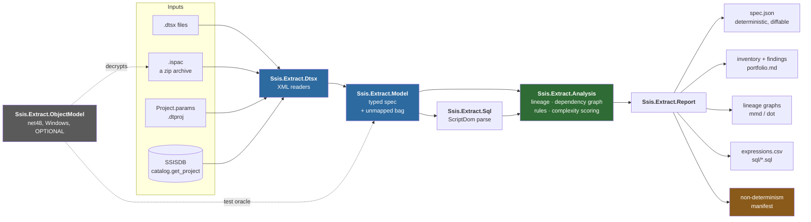
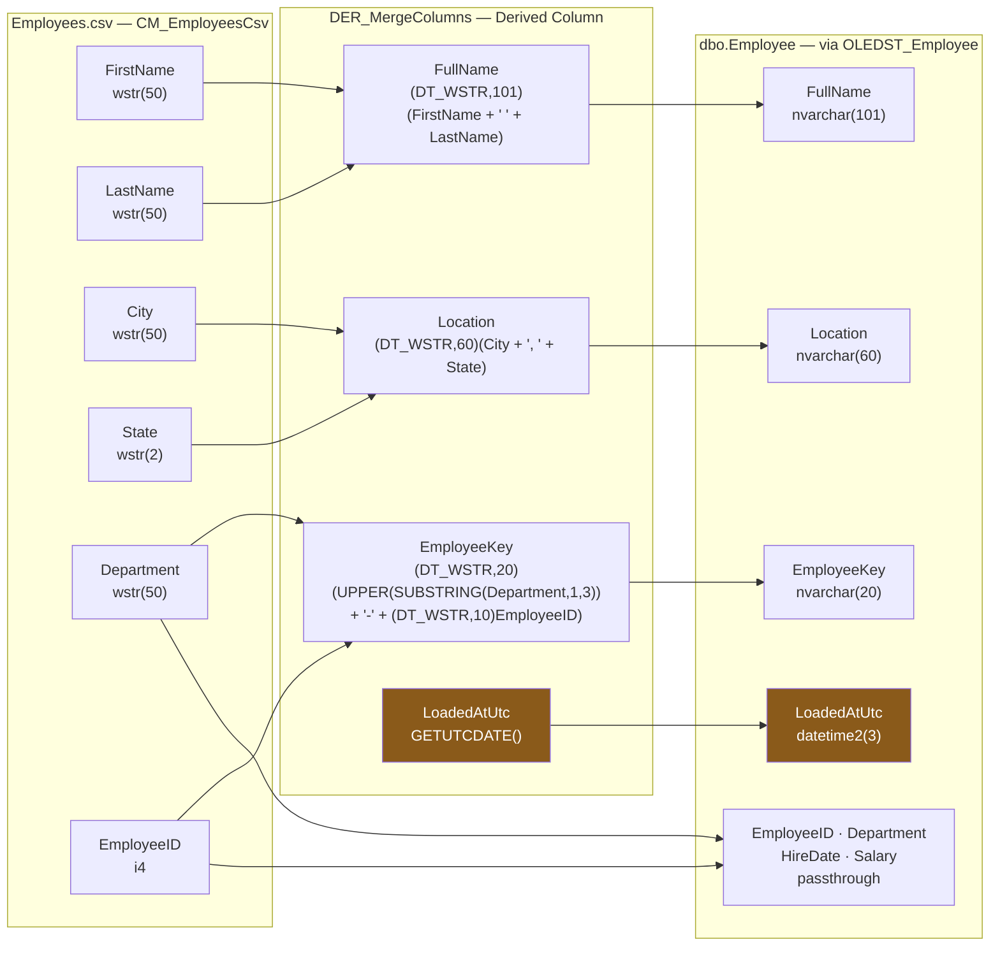

# Phase 0 — SSIS Package Extractor: detailed build plan

**Status:** plan only. Nothing implemented yet.
**Target:** a standalone C# tool (`ssisx`) that turns a folder of `.dtsx` /
`.ispac` files into a machine-readable **spec** plus human-readable
inventory, lineage, and risk reports — the requirements document nobody
wrote for the client's 50+ packages.

This plan is grounded in the actual XML of this PoC's two packages
(`SSIS/LoadEmployees.dtsx`, `SSIS/LoadReferenceData.dtsx`), which are the
first fixtures. Every element named below was read out of those files or
`Project.params`/`SSIS.dtproj` — it is not a guess about the format.

Related: `PoC-Architecture-Overview.md` §1–2 (what the packages are),
`CLAUDE.md` (environment facts and traps this tool must respect).

---

## 1. What "done" means for phase 0

Point `ssisx` at the client's package source (or at their deployed SSISDB)
and get, without an SME and without opening Visual Studio:

1. **Inventory** — every package, what it reads, what it writes, how big and
   how complex it is, classified *Simple / SQL-heavy / Procedural / High-risk*.
2. **Spec** — a deterministic JSON per package capturing everything the file
   actually says, including the parts we don't yet model (nothing is
   silently dropped).
3. **Lineage** — per destination column, the full chain from source column
   through every expression to the target table column and type.
4. **Risk findings** — the things that will hurt during rewrite (script
   tasks, SCD, third-party components, checkpoints, transactions, legacy
   configurations, non-deterministic values).
5. **Test seed** — every SSIS expression and every SQL statement, extracted
   as individually addressable artifacts, so unit tests and the later
   parallel-run diff can be generated from them rather than hand-written.

Explicit non-goal for phase 0: **no code generation, no rewriting, no
conversion.** The tool reads and describes. Anything that emits replacement
C# is phase 2 and a different risk profile.

---

## 2. Design decisions (and what was rejected)

### 2.1 Parse the XML directly — do **not** use the SSIS object model as the primary path

I previously suggested using `Application.LoadPackage` + the object model
(the same API `Scripts/PkgRun.cs` uses). Having now read the raw XML of both
packages, **I'm changing that recommendation.** Direct XML parsing should be
the primary engine, for four reasons:

| | XML parsing (`System.Xml.Linq`) | SSIS object model (`Microsoft.SqlServer.ManagedDTS`) |
|---|---|---|
| Runtime | **net8.0, any OS**, no SSIS installed | net48 + Windows + matching SSIS version in the GAC |
| Version handling | reads exactly what is on disk, any `PackageFormatVersion` | **silently upgrades** an older package in memory; needs the right version installed or fails to load |
| Unknown/third-party components | captured verbatim as raw XML | may fail to load if the component isn't registered on the box |
| Encrypted packages (`EncryptAllWithPassword`) | cannot read | **can decrypt given the password** |
| CI | runs on a Linux build agent | Windows agent only |

The decisive one is version tolerance. The client's 50 packages were
authored over years by unknown people on unknown SSIS versions; a tool that
requires the exact right SSIS runtime installed to read a file is a tool
that will fail on the packages you most need to understand. Everything in
this plan's extraction list is present in the file on disk — verified by
reading it.

**The object model still earns its place, in two narrow roles:**

- **As a test oracle** (§7.3): load the same package both ways, assert the
  counts match. That validates the XML parser instead of trusting it.
- **As the decryption fallback** for `ProtectionLevel = EncryptAllWithPassword`
  packages, where the XML is opaque. Isolated in one optional net48 project
  that the main tool never references.

### 2.2 Separate solution, zero coupling to this PoC

The tool must be usable against the client's repo, so it takes no dependency
on anything here. This PoC's two packages are *fixtures*, referenced by path.

It also must **not** be added to `SSIS.sln` — that solution declares only the
custom `Default` platform (an SSDT/dtproj quirk) and devenv silently skips
cross-mapped C# projects in it (`CLAUDE.md` trap 6). Its own `.sln`,
built with `dotnet build`, avoids that entirely.

### 2.3 Deterministic, redacted, lossless output

Three properties that are cheap now and expensive to retrofit:

- **Deterministic** — sorted keys, stable ordering, run metadata segregated
  into a `_meta` block. Consequence: spec JSON can be committed to git, and
  `git diff` on it becomes a *package change detector*. That is how you spot
  the package someone edited in production last March.
- **Redacted by default** — passwords stripped from every connection string;
  `--no-redact` to opt out. These JSON files will get emailed around.
- **Lossless** — every XML element the typed model doesn't recognise is kept
  in an `unmapped` bag, and the tool reports a **coverage percentage** (§7.2).
  With no SME, an honest "we understood 94% of this file, here are the 6%"
  is worth far more than a confident partial model.

---

## 3. Project layout



Note where the net48 object-model project sits: off to the side, dotted, used
as a **test oracle** and an encrypted-package fallback — never in the main
path (§2.1). `non-determinism manifest` is highlighted because it is the one
output consumed directly by a later phase (see `Migration-Validation-Plan.md`).


```
Tools/SsisExtractor/
  SsisExtractor.sln
  src/
    Ssis.Extract.Model/        net8.0  POCOs for the spec + JSON contract + versioning
    Ssis.Extract.Dtsx/         net8.0  XML readers: .dtsx, Project.params, .dtproj, .ispac(zip)
    Ssis.Extract.Analysis/     net8.0  lineage graph, dependency graph, rules engine, scoring
    Ssis.Extract.Sql/          net8.0  T-SQL parsing via Microsoft.SqlServer.TransactSql.ScriptDom
    Ssis.Extract.Report/       net8.0  markdown / CSV / HTML / mermaid / DOT emitters
    Ssis.Extract.Catalog/      net8.0  optional: read packages + runtime stats from SSISDB
    Ssis.Extract.Cli/          net8.0  `ssisx` entry point (System.CommandLine)
    Ssis.Extract.ObjectModel/  net48   OPTIONAL, Windows-only: oracle + encrypted-package fallback
  tests/
    Ssis.Extract.Tests/        net8.0  golden-file + coverage tests
    fixtures/                          the two PoC packages + synthetic edge cases
  docs/
    spec-schema.md                     the JSON contract, versioned
```

**Dependencies, deliberately few:** `System.CommandLine`,
`Microsoft.SqlServer.TransactSql.ScriptDom` (netstandard2.0, works on net8),
`Microsoft.Data.SqlClient` (only in `.Catalog`). No SSIS assemblies in the
main path — that is the point.

`Ssis.Extract.ObjectModel` is `net48` because `Microsoft.SqlServer.ManagedDTS`
has no .NET Core build, and must be built **x64** (`CLAUDE.md`: `DTSRuntimeWrap`
is `GAC_64`). It is referenced only by the test project and an opt-in CLI flag.

---

## 4. What gets extracted — the full inventory

This is the core of the plan. Organised by layer; every item below is
present in the two PoC packages' XML unless marked *(not in PoC — needs a
synthetic fixture)*.

### 4.1 Project level

From `SSIS.dtproj` / `Project.params` / `.ispac`'s `@Project.manifest`:

- `DeploymentModel` (Project vs Package — the latter changes everything
  about how values are supplied), `ProductVersion`, `SchemaVersion`
- Project `ProtectionLevel`, version major/minor/build/comments/GUID
- Package list with each one's `PackageFormatVersion`, `ProtectionLevel`,
  `VersionGUID` — lets you detect **source/deployed drift** without opening
  the packages
- Project-scoped **connection managers** (empty in this PoC, common in the wild)
- Project **parameters**: name, `DataType`, `Value`, `Required`, `Sensitive`,
  `Description`, `ID`
  - Note the type-code trap: `DataType 18` in `Project.params` means String
    (.NET `TypeCode`), while `DTS:DataType="8"` inside a `.dtsx` also means
    String (SSIS `DT_WSTR`). **Two different enums for the same concept**
    (`CLAUDE.md` trap 12) — the extractor needs two separate lookup tables
    and must never share one.
- Build configurations and their `TargetServerVersion`

### 4.2 Package level

- Identity: `ObjectName`, `Description`, `DTSID`, `refId`, file path,
  **SHA-256 of the file**, size, last-write time
- Provenance: `CreationDate`, `CreatorName`, `CreatorComputerName` — free
  archaeology; tells you who and which machine, and groups packages by author
- Versioning: `PackageFormatVersion`, `LastModifiedProductVersion`,
  `VersionBuild`, `VersionGUID`, `VersionComment`
- `ProtectionLevel` (numeric → name), `PackageType`, `LocaleID`
- **Execution semantics that must be replicated by any rewrite** —
  `MaxConcurrentExecutables`, `MaximumErrorCount`, `FailPackageOnFailure`,
  `DelayValidation`, `TransactionOption`, `IsolationLevel`,
  `ForceExecutionResult`, `Disable`, `DisableEventHandlers`
- **Checkpoints**: `CheckpointUsage`, `CheckpointFileName`, `SaveCheckpoints`
  *(not in PoC)* — restart-from-failure semantics; if a package uses these,
  a naive rewrite changes behaviour on retry
- **Package configurations** (`EnableConfigurations` + `<DTS:Configurations>`)
  *(not in PoC)* — XML file / env var / registry / parent variable / SQL
  config table. This is the legacy Package Deployment Model's parameter
  mechanism, and it is where a huge amount of undocumented environment
  coupling lives in older packages. Must be extracted with the config type
  and the target property path.
- Logging: `LoggingMode`, `LoggingOptions` (event filter kind + filter list),
  `LogProviders` (type + `ConfigString`)
- Package-level `PropertyExpression`s
- Package **parameters** (same shape as project parameters, package scope)

### 4.3 Connection managers (project + package scope)

Per connection manager:

- `ObjectName`, `refId`, `DTSID`, `Description`, `CreationName` (the type:
  `OLEDB`, `FLATFILE`, `FILE`, `ADO.NET`, `EXCEL`, `ODBC`, `FTP`, `SMTP`,
  `HTTP`, `MSMQ`, `SMOServer`, `WMI`, `CACHE`, `MULTIFLATFILE`, …)
- `ConnectionString` — **stored twice**: `raw` (redacted) and `parsed` into
  `{ server, database, provider, authMode, userId, filePath, extras{} }`.
  Parsing it is what makes "which packages hit which server" answerable.
- `DelayValidation`, `RetainSameConnection` — the latter is load-bearing
  semantics (shared transaction / `#temp` table visibility), silently
  destroyed by a rewrite that opens a connection per operation
- `PropertyExpression` on `ConnectionString` — *how* it is parameterised.
  In `LoadEmployees` this is `@[User::SourceFilePath]`; in `LoadReferenceData`
  the whole string comes from a parameter. Both shapes must be captured.
- **Flat file specifics** (a complete, directly reusable file-format spec):
  `Format`, `LocaleID`, `CodePage`, `Unicode`, `HeaderRowsToSkip`,
  `HeaderRowDelimiter`, `RowDelimiter`, `ColumnNamesInFirstDataRow`,
  `TextQualifier`, and per column: `ObjectName`, `ColumnType`,
  `ColumnDelimiter`, `DataType`, `MaximumWidth`, `DataPrecision`,
  `DataScale`, `TextQualified`.
  This converts almost 1:1 into a `CsvHelper`/`Sep` reader configuration —
  it is the single most directly reusable artifact the extractor produces.
  (And it is where `CLAUDE.md` trap 2 lives: a CRLF `RowDelimiter` against
  an LF file gives **silent 0-row loads**. The extractor should surface the
  delimiter explicitly so that trap is visible, not buried.)
- **Derived**: role classification — `source` / `target` / `both` / `unused`,
  computed from which components reference it. "Unused connection manager"
  is a real and common finding.

### 4.4 Variables

At **every** scope, not just package scope — variables can be declared on
any container, and container-scoped variables are a classic hiding place:

- `Namespace`, `ObjectName`, `DataType`, value, `EvaluateAsExpression`,
  `Expression`, `ReadOnly`, `IncludeInDebugDump`, `DTSID`
- Owning container `refId` (the scope)
- **Derived**: read/write usage map — which tasks, expressions, and
  components reference each variable; flag **unused** variables and
  variables written by a Script Task (opaque data flow).

### 4.5 Control flow — recursive executable tree

Walk `<DTS:Executables>` recursively. Common attributes for every node:

`refId`, `ObjectName`, `Description`, `DTSID`, `ExecutableType` /
`CreationName`, `Disabled`, `DelayValidation`, `FailParentOnFailure`,
`FailPackageOnFailure`, `MaximumErrorCount`, `TransactionOption`,
`IsolationLevel`, `ForcedExecutionValue`, `ThreadHint`, plus any
`PropertyExpression`s and container-scoped `Variables`.

Container types needing extra handling:

- **Sequence** — just recurse
- **ForEach Loop** *(not in PoC)* — enumerator type and its config:
  - File enumerator: folder, file spec, retrieve-file-name mode, traverse
    subfolders
  - ADO / ADO.NET schema rowset / From Variable / Item / NodeList / SMO
  - **variable mappings** (which variable receives which enumerated value)
- **For Loop** *(not in PoC)* — `InitExpression`, `EvalExpression`,
  `AssignExpression`

Task payloads — each gets a typed model:

| Task | Extract |
|---|---|
| **Execute SQL** | `SqlStatementSource` (**full SQL text**), `SqlStatementSourceType` (DirectInput/FileConnection/Variable), `Connection` (a DTSID — resolve to the CM name), `IsStoredProc`, `ResultSetType`, **parameter bindings** (variable ↔ ordinal/direction/type), **result-set bindings**, `TimeOut`, `CodePage`, `BypassPrepare` |
| **Data Flow** (`Microsoft.Pipeline`) | the whole pipeline — §4.7 |
| **Script Task** *(not in PoC)* | `ScriptLanguage`, `EntryPoint`, `ReadOnlyVariables`, `ReadWriteVariables`, and **the full source of every `ProjectItem`** written out as `.cs`/`.vb` files; flag whether only the compiled binary is present (source stripped) |
| **Execute Package** *(not in PoC)* | child package reference (project reference vs file vs SQL Server), `ExecuteOutOfProcess`, parameter bindings — **this is the edge list for the cross-package dependency graph** |
| **File System** *(not in PoC)* | `Operation`, source/destination (connection or variable), `OverwriteDestination` |
| **Execute Process** *(not in PoC)* | `Executable`, `Arguments`, `WorkingDirectory`, `SuccessValue`, `TimeOut`, stdout/stderr variables — arbitrary shell-out, always a finding |
| **Bulk Insert** *(not in PoC)* | file, target table, format options |
| **FTP / Send Mail / Web Service / XML / WMI / Message Queue** *(not in PoC)* | connection + operation + payload |
| **Transfer\*** / **Analysis Services** *(not in PoC)* | source/destination + objects |
| **Anything else** | `ExecutableType` + the **raw `<DTS:ObjectData>` XML verbatim**, flagged `unmapped: true` |

That last row is mandatory. On 50 unknown packages you *will* meet a task
type this plan didn't anticipate, and the tool must report it loudly rather
than skip it silently.

### 4.6 Event handlers and precedence constraints

- **Event handlers** on every executable at every depth (`OnError`,
  `OnTaskFailed`, `OnPreExecute`, `OnPostExecute`, `OnWarning`,
  `OnVariableValueChanged`, …). Each is a full container tree — recurse with
  the same code as §4.5. *(Not in this PoC, but per my earlier analysis this
  is exactly where undocumented error handling hides: the retry that emails
  someone, the compensating delete nobody remembers.)*
- **Precedence constraints**: `From`, `To`, `Value` (Success/Failure/
  Completion), `EvalOp` (Constraint / Expression / ExpressionAndConstraint /
  ExpressionOrConstraint), `Expression`, `LogicalAnd`.
  - **Derived**: build the DAG per container. Compute topological order,
    identify **parallel branches** (nodes with no ordering between them —
    these must stay parallel or the rewrite gets slower), and highlight
    **failure paths** separately from success paths.

`LoadEmployees` has exactly one: `SQL_TruncateTarget → DFT_LoadEmployees`,
`LogicalAnd=True`, no expression. That's the smallest possible DAG and makes
a clean first test.

### 4.7 Data Flow (pipeline) — the deepest layer

Per component:

- `refId`, `name`, `description`, `componentClassID` (normalise both the
  friendly form `Microsoft.DerivedColumn` and the versioned/GUID forms older
  packages use), `contactInfo`, `version`, `localeId`,
  `validateExternalMetadata`, `usesDispositions`
- **All `<properties>`** as a name/value/dataType dictionary — generic, so
  third-party components are captured without a bespoke handler
- **Connections used** → `connectionManagerRefId`, resolved to the CM name
- **Inputs**: name, `refId`, `errorRowDisposition`, `truncationRowDisposition`,
  `hasSideEffects`; per input column: `cachedName`, `cachedDataType`,
  `cachedLength`/`precision`/`scale`/`codepage`, **`lineageId`**,
  `externalMetadataColumnId`, and per-column `<properties>`
- **Outputs**: name, `refId`, `isErrorOut`, **`synchronousInputId`** (present
  ⇒ synchronous transform; absent ⇒ **asynchronous**, i.e. a blocking/
  semi-blocking memory consumer — a performance fact worth reporting),
  `exclusionGroup`, `deleteOutputOnPathDetached`; per output column:
  `dataType`, `length`, `precision`, `scale`, `codePage`, `lineageId`,
  `errorRowDisposition`, `truncationRowDisposition`,
  `errorOrTruncationOperation`, and **its `<properties>`** — which is where
  the expressions live
- **`externalMetadataColumns`** — the design-time contract with the external
  schema (name, dataType, length, precision, scale). Comparing this against
  the *live* database schema is a cheap, high-value check: it finds packages
  whose cached metadata has drifted from the table they write to.
- **Paths**: `startId` → `endId`, `name`

Component-specific semantic extraction on top of the generic model:

| Component | Extract |
|---|---|
| **Derived Column** | per output column both `Expression` (with `#{lineageId}` refs) and **`FriendlyExpression`** (human-readable). Keep both: the friendly one for humans and test generation, the refId one to resolve exact lineage. |
| **OLE DB / ADO.NET Source** | `AccessMode` (OpenRowset / OpenRowsetVariable / **SqlCommand** / SqlCommandVariable), `OpenRowset` (table), **`SqlCommand`** (full SQL), parameter mappings |
| **OLE DB Destination** | `AccessMode`, `OpenRowset` (**target table**), `FastLoadOptions` (TABLOCK, CHECK_CONSTRAINTS, ROWS_PER_BATCH…), `FastLoadKeepIdentity`, `FastLoadKeepNulls`, `FastLoadMaxInsertCommitSize`, `CommandTimeout`, and the **input↔external column mapping** |
| **Flat File Source/Destination** | connection + column mapping, `Overwrite`, header |
| **Lookup** *(nP)* | reference table or `SqlCommand`, join columns, output columns + aliases, **cache mode** (Full/Partial/None), **`NoMatchBehavior`** (fail vs redirect) — silently changes row counts |
| **Conditional Split** *(nP)* | per output: condition expression + evaluation order + which is the default output |
| **Aggregate** *(nP)* | group-by columns, aggregate operations per column |
| **Sort** *(nP)* | sort key position, comparison flags, `EliminateDuplicates` |
| **Merge / Merge Join** *(nP)* | join type + join keys |
| **Union All** *(nP)* | cross-input column mapping |
| **Data Conversion** *(nP)* | per-column target type/length/codepage |
| **Row Count / Multicast / Copy Column / Character Map** *(nP)* | variable target, fan-out, mappings |
| **Slowly Changing Dimension** *(nP)* | business keys, per-column SCD type (fixed/changing/historical) — **always high-risk**, a wizard-generated subgraph that is painful to reproduce |
| **OLE DB Command** *(nP)* | `SqlCommand` + parameter mapping — row-by-row execution; always a performance finding |
| **Script Component** *(nP)* | same source extraction as Script Task, plus input/output column usage |
| **Unknown / third-party** | raw properties dictionary verbatim, `unmapped: true` |

*(nP = not present in this PoC; needs a synthetic fixture or a real client
package before it can be claimed to work.)*

---

## 5. Derived analysis — where the value actually is

Extraction is table stakes. These are the outputs that answer questions.

### 5.1 Column lineage graph

Resolve every `lineageId` to its producing component+column, then follow
`<paths>` to chain hops. For `LoadEmployees` this yields, per target column:



That graph is generated, not drawn — and note `LoadedAtUtc` highlighted with
**no source edge**: nothing feeds it, because `GETUTCDATE()` is a constant
function. That is precisely how the non-determinism manifest (§5.8) is
derived, and why it comes out of the lineage pass for free.

Emit as JSON edges plus Mermaid and Graphviz DOT. **This is the single most
valuable artifact for a rewrite**: it *is* the transformation spec, and each
edge with an expression on it is directly a unit test case.

Also flags automatically: unused source columns (read but never landed),
target columns with no source (constants/defaults), and type/length
narrowing along a chain (a truncation risk the package tolerates today).

### 5.2 Cross-package dependency graph

Edges from Execute Package Tasks, **plus** implicit edges from shared
tables: package A writes `dbo.X`, package B reads `dbo.X` ⇒ an ordering
dependency that exists in the schedule, not in any package. On 50 packages
this graph is usually the first time anyone has seen the real execution
order, and it determines migration sequencing.

### 5.3 Data-touch inventory

Every table/view/proc read, every table written, every file path read or
written, every SMTP/FTP/HTTP endpoint — per package and rolled up across the
portfolio. Answers "what does this thing actually touch" and finds the
orphans: files nobody consumes, tables nobody reads.

### 5.4 SQL harvest + parse

Every SQL statement (Execute SQL Task, OLE DB Source `SqlCommand`, Lookup
query, OLE DB Command) written to its own `.sql` file, then parsed with
**`Microsoft.SqlServer.TransactSql.ScriptDom`** (a NuGet package, netstandard2.0,
runs fine on net8) to extract referenced objects, statement types, and flag
`TRUNCATE`/`DELETE`/`MERGE`/dynamic SQL. Cheap to add, and it turns SQL text
from an opaque blob into structured dependency data feeding §5.3.

### 5.5 Expression harvest

Every SSIS expression in one table — derived columns, conditional splits,
variable expressions, property expressions, precedence-constraint expressions
— with its location, its friendly form, and the columns/variables it reads.

Two uses: (a) each row becomes a **table-driven unit test case** for the
rewrite; (b) tokenise the expressions to inventory **which SSIS functions the
portfolio actually uses**. That tells you exactly how much of the SSIS
expression language a replacement engine must support, and surfaces the ones
with no clean .NET equivalent (`TOKEN`, `REPLACENULL`, `(DT_STR,n,codepage)`
casts, `NULL(DT_WSTR,n)`) before someone discovers them mid-sprint.

### 5.6 Complexity scoring and classification

Counts (tasks, containers, data flows, components, expressions, SQL
statements, script tasks, loops, event handlers, unmapped nodes) feed a
weighted score → **Simple / SQL-heavy / Procedural / High-risk**, which is
the phase-0 classification the whole migration sequencing depends on.
Weights live in a config file, not in code, so they can be tuned once the
client's real distribution is visible.

### 5.7 Findings (rules engine)

Named rules, each producing findings with severity and location. Initial set:

**Rewrite-effort:** script task/component present · third-party component ·
SCD component · OLE DB Command (RBAR) · async transform (Sort/Aggregate) ·
ForEach loop · Execute Process Task.

**Semantics that silently break in a rewrite:** checkpoints in use ·
`TransactionOption=Required` · `RetainSameConnection=True` ·
`MaximumErrorCount > 1` (**tolerates failures silently**) ·
`ForceExecutionResult` set · `ValidateExternalMetadata=false` ·
error outputs redirecting rows to nowhere.

**Environment coupling:** hardcoded server/path in a connection string ·
package configurations (legacy deployment model) · `Password=` present ·
`ProtectionLevel=EncryptSensitiveWithPassword`/`EncryptAllWithPassword`.

**Dead/suspicious:** disabled tasks · unused variables · unused connection
managers · unconnected components · duplicate packages (same file hash or
near-identical component graph).

**Non-determinism (feeds phase 2 directly, see §9):** every column produced by
`GETDATE()`, `GETUTCDATE()`, `NEWID()`, `@[System::…]`, or an identity column.

### 5.8 Non-determinism manifest — the explicit phase-0 → phase-2 handoff

Worth calling out separately because it's the one output that makes the later
parallel-run diff harness cheap instead of painful. The extractor emits, per
target table, **the list of columns that cannot be compared** because they are
non-deterministic — in this PoC, `dbo.Employee.LoadedAtUtc` (`GETUTCDATE()`),
`dbo.Department.LoadedAtUtc`, `dbo.Designation.LoadedAtUtc`.

The diff harness reads that manifest and excludes those columns from its row
hash automatically. Without it, someone hand-maintains an exclusion list and
gets it wrong, and you spend a week chasing false-positive diffs.

---

## 6. Outputs and CLI

### 6.1 Output tree

```
out/
  _meta.json                     tool version, run time, inputs, coverage summary
  project.spec.json
  packages/<Package>.spec.json   the canonical per-package spec
  inventory.csv | inventory.md   one row per package: counts, class, risk score
  findings.csv  | findings.md    every rule hit, with severity + location
  lineage/<Package>.mmd | .dot   column lineage graphs
  graph/portfolio.mmd            cross-package dependency graph
  sql/<Package>/<Task>.sql       every SQL statement, individually addressable
  expressions.csv                every expression, for test seeding
  nondeterministic.json          the §5.8 manifest
  scripts/<Package>/<Task>/*.cs  extracted Script Task/Component source
  unmapped.md                    everything the model did not understand
  portfolio.md                   the readable "here is what you own" report
```

### 6.2 Commands

```
ssisx extract --input <dir|file.dtsx|file.ispac|file.dtproj> [--recursive]
              --out <dir> [--no-redact] [--password <pw>] [--fail-under <coverage%>]

ssisx report  --in <out-dir> [--format md|html|csv]
ssisx graph   --in <out-dir> [--scope package|portfolio]

ssisx diff    --left <a.spec.json> --right <b.spec.json>
              # semantic diff between two versions of the same package —
              # e.g. source control vs what's actually deployed

ssisx pull    --catalog "<connstr>" [--folder <f>] [--project <p>] --out <dir>
              # read the deployed .ispac straight out of SSISDB via
              # catalog.get_project, then extract it

ssisx enrich  --in <out-dir> --catalog "<connstr>"
              # attach observed runtime facts from
              # catalog.execution_data_statistics / catalog.executions
```

Two of these deserve a note:

- **`pull`** matters more than it looks. On a client engagement, source
  control and what is actually running in production have usually drifted.
  Extracting from SSISDB and `diff`ing against extraction from the repo tells
  you *which packages you cannot trust the source of* — on day one, before
  anyone has estimated anything.
  (`.ispac` is just a zip — `CLAUDE.md` trap 1 — so `ZipArchive` reads it; and
  `catalog.get_project` returns the bytes over TDS, no SSIS install needed.)
- **`enrich`** joins static structure to observed behaviour:
  `catalog.execution_data_statistics` gives **rows per component per
  execution**, `catalog.executions` gives durations. Static analysis says what
  the package *is*; this says what it actually *does* — including "this data
  flow has processed zero rows for six months."

---

## 7. How we know the extractor is correct

Three independent checks, because "the tool said so" is exactly the failure
mode this whole programme exists to avoid.

### 7.1 Golden-file tests
Expected `spec.json` for both PoC packages committed to the repo; tests
assert byte-equality against freshly generated output. Any parser change that
alters output shows up as a reviewable diff. (This works *because* the output
is deterministic — §2.3.)

### 7.2 Coverage metric — the honesty check
Count XML elements/attributes in the source file vs those consumed by a typed
handler. Report **coverage %** per package and list every unconsumed element
path in `unmapped.md`. Add `--fail-under 95` so CI fails when a new package
introduces structure the model doesn't understand.

This is the metric that makes the tool trustworthy without an SME: it
converts "we think we extracted everything" into a number plus a to-do list.

### 7.3 Object-model oracle (test-only, Windows-only)
`Ssis.Extract.ObjectModel` loads the same package via
`Application.LoadPackage` and asserts the XML-derived model agrees on the
things the object model can independently confirm: executable count and
names, connection manager count/types, variable count, parameter count/types,
pipeline component and path counts, precedence constraint count.

This uses the object model as a **reference implementation to test against**,
not as the production path — keeping the Windows/GAC dependency (and its
version-upgrade side effects, §2.1) entirely out of the shipping tool.

---

## 8. Build slices

Sized for one developer. Each slice ends with tests green and something
demoable.

| # | Scope | Est. | Demo at the end |
|---|---|---|---|
| 1 | Model + `.dtsx`/`Project.params`/`.dtproj` readers, package/CM/variable/parameter layers, `extract` CLI, deterministic JSON, golden tests | 3 d | `LoadEmployees.spec.json` complete down to flat-file column definitions |
| 2 | Control flow tree, all task payloads, event handlers, precedence DAG, unmapped passthrough + coverage metric | 3 d | Full control flow + SQL text; coverage % reported |
| 3 | Pipeline model, all component types, lineage resolution, Mermaid/DOT | 4 d | Column-level lineage graph for both PoC packages |
| 4 | Rules engine, complexity scoring, inventory + findings + portfolio reports, non-determinism manifest | 3 d | The "here is what you own" report — **the actual phase-0 deliverable** |
| 5 | `.ispac` input, `pull` from SSISDB, `diff`, ScriptDom SQL analysis, expression harvest + test scaffolds | 3 d | Source-vs-deployed drift detection |
| 6 | `enrich` with catalog runtime stats; object-model oracle tests | 2 d | Static + observed row counts side by side |

≈ **3.5 weeks** to slice 6, ≈ **2.5 weeks** to the slice-4 deliverable. That
matches the "phase 0: 2–3 weeks" estimate, with the caveat below.

Slices 1–4 can be built entirely against this PoC. Slices 5–6 need the
client's catalog, but can be developed against the PoC's own SSISDB first —
which is exactly why having a working catalog here is useful beyond the PoC.

**The estimate's real risk is component coverage, not code volume.** Slices
1–4 handle what this PoC contains: flat file source, derived column, OLE DB
destination, Execute SQL. The client's 50 packages will contain Lookups,
Conditional Splits, ForEach loops, Script Tasks and probably an SCD. Each
unfamiliar component is roughly half a day of "read one real example, model
it, test it." **Getting 3–5 representative real packages early is worth more
than any amount of upfront design** — recommend asking for them before slice 3.

---

## 9. How this feeds the later phases

- **Phase 1** (containerised control plane, still calling SSIS) — the
  inventory and dependency graph decide what the control plane must schedule
  and in what order.
- **Phase 2** (metadata-driven engine + diff harness) — the spec JSON *is*
  the metadata input; the expression harvest seeds the unit tests; the
  **non-determinism manifest (§5.8) configures the row-hash diff's exclusion
  list automatically**; the lineage graph is the acceptance criteria for each
  migrated package.
- **Phase 3** (long tail) — the complexity score sets the order, and the
  findings list is the pre-read for each package before anyone touches it.

---

## 10. Risks and honest limits

- **Structure ≠ intent.** The extractor tells you exactly what a package
  does mechanically. It cannot tell you *why* a filter excludes region 7.
  Only the parallel-run diff (phase 2) and, eventually, a business user can.
  Do not let a complete-looking spec create false confidence.
- **Script Tasks are extracted, not understood.** You get the C#/VB source;
  its behaviour is still a manual read. If the source was stripped and only
  the compiled binary remains, you get a flag and nothing else.
- **Encrypted packages** (`EncryptAllWithPassword`) need the password and the
  net48 fallback path. Find out early how many the client has.
- **Package Deployment Model configurations** — if the client is on the old
  model, a large share of real behaviour lives in XML config files, registry
  keys, or a SQL config table *outside* the packages. The extractor flags
  their presence but cannot read what it isn't pointed at; budget for
  collecting those files too.
- **Phase 0 will find surprises** — duplicate packages, packages nobody runs,
  packages that have been failing silently for months (`MaximumErrorCount > 1`
  makes this possible and the rules engine will catch it). This is good news
  that inflates scope. Plan for it.
- **`ssisx diff` may show that source control is not the truth.** Better to
  know in week one.

---

## 11. Decisions I need from you before implementation

1. **Repo location** — `Tools/SsisExtractor/` inside this PoC repo (easy,
   fixtures to hand), or a separate repo from the start (cleaner for handing
   to the client)? I'd default to the former for the prototype and extract it
   later; it costs nothing because there's no coupling either way.
2. **Real packages** — can we get 3–5 representative client `.dtsx` files
   (redacted is fine) before slice 3? This is the single biggest accuracy
   lever and the main estimate risk (§8).
3. **Build order** — straight through slices 1→6, or stop at slice 4 (the
   readable inventory) and reassess with real packages in hand? I'd
   recommend the latter.
4. **`pull`/`enrich` scope** — will we get read access to the client's
   SSISDB? If yes, `pull` and `enrich` become the highest-value slices and
   should move earlier; if no, drop slice 6 entirely.
