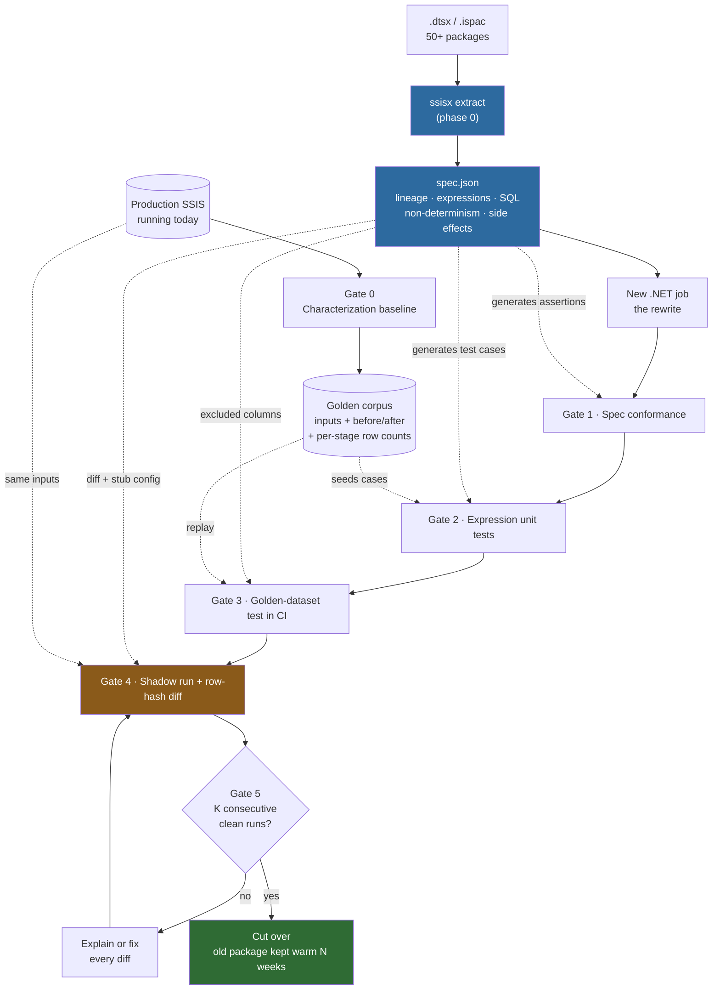
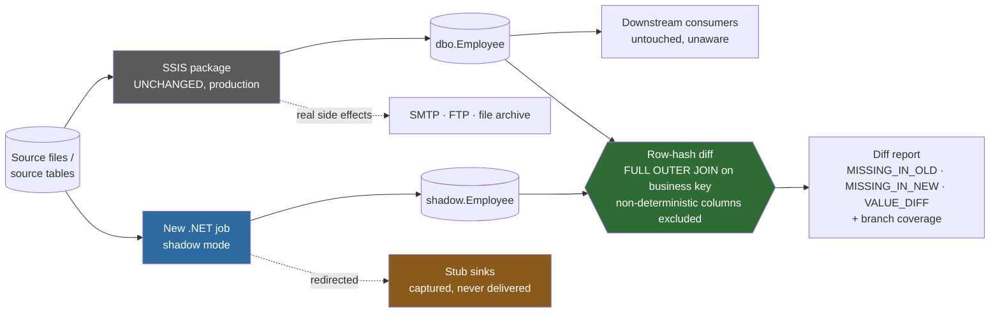

# Validating the rewrite — end-to-end plan

**The question:** we rewrite an SSIS package as .NET. How do we *prove* the
new code is a true end-to-end replacement, with no SME, no documentation, and
50+ packages to get through?

**The short answer:** six gates, each catching a different class of defect.
The extractor (`Phase0-Extractor-Plan.md`) is what makes gates 1–3 *generated*
rather than hand-written — that's the leverage that makes this affordable
across 50 packages instead of 50 bespoke test efforts.

**The governing constraint:** anything that costs a week per package is
unaffordable at 50 packages. Every gate below must be a **harness configured
per package from the spec**, not a bespoke test suite someone writes by hand.
If you find yourself writing package-specific test code, that's a signal the
harness is missing a feature.



The dotted lines are the point of the whole exercise: **the extractor's output
is what configures the gates**, so onboarding package #37 is producing a config
file, not writing a test suite.

---

## 1. The six gates at a glance

| Gate | What it proves | What it catches | What it misses | Per-package cost |
|---|---|---|---|---|
| **0. Characterization baseline** | what the old package *actually does today* | nothing yet — it's the reference | — | hours (mostly waiting for runs) |
| **1. Spec conformance** | the new code implements every rule the spec found | missing columns, missing tasks, dropped transformations | wrong logic that's present | minutes (generated) |
| **2. Expression unit tests** | each transformation rule is individually correct | expression bugs, truncation, type/rounding errors, NULL handling | wiring between correct pieces | minutes (generated) |
| **3. Golden-dataset integration test** | the whole package, end to end, on known input, in CI | wiring, ordering, schema mismatch, regressions | edge cases absent from golden data | hours once, then free |
| **4. Parallel/shadow run + row diff** | the new code matches the old on **real production data** | the 2014 edge case nobody documented | side effects outside the DB; untriggered rare paths | days–weeks elapsed, low effort |
| **5. Cutover gate + watch** | it stayed correct over time, and we can roll back | intermittent/periodic-only behaviour (month-end) | — | elapsed time only |

No single gate is sufficient. Gates 1–3 are fast and run in CI on every
commit. Gate 4 is the one that actually earns trust, and it's the only one
that can find behaviour nobody knew existed.

---

## 2. Gate 0 — characterization baseline (before writing any new code)

This is the step most often skipped, and skipping it makes everything after
it guesswork. You are not testing what the package *should* do. You are
pinning down what it *does* do, and that recording becomes the reference.

Three things to capture, from production, before touching anything:

1. **Golden datasets** — for N real runs (aim for 10–30 days, and make sure
   the window includes a month-end):
   - the exact input files / source query result sets
   - a snapshot of every target table **before** and **after** the run
   - the run's parameter values and execution timestamp

2. **Runtime facts from SSISDB** — turn logging up for the window, then pull:
   - `catalog.execution_data_statistics` → **rows per component per
     execution**. This is free, per-hop lineage truth and gives you the
     expected row counts each stage should produce.
   - `catalog.executions` → durations, for the performance baseline. "Is the
     new one fast enough" needs a number to compare against.
   - `catalog.operation_messages` → warnings the package emits routinely
     that everyone has learned to ignore. Some of them matter.

3. **Side-effect inventory** — from the extractor's data-touch inventory
   (§5.3 of the extractor plan): every file written, email sent, proc called,
   FTP endpoint hit. You cannot validate what you didn't know happened.

**Why this must come first:** once you start changing things, you lose the
ability to answer "was it like that before?" And on packages with no SME,
that question comes up constantly.

**Storage:** the golden corpus needs a home — object storage or a dedicated
database, with the input files and table snapshots keyed by run. Budget for
this; it's not large but it needs to be versioned and durable, because it's
your evidence for the go-live decision.

---

## 3. Gate 1 — spec conformance (generated from the extractor)

> **Built.** `ssisx conformance` implements this gate — it generates the obligations
> below as `ConformanceRuleSpec` rules, joins them against hand-maintained claim files,
> and exits non-zero under `--check` unless every obligation is accounted for. See
> `Tools/SsisExtractor/docs/conformance-schema.md`. Measured on this PoC: 31 obligations
> for `LoadEmployees`, 49 for `LoadReferenceData`. Gate 2 is now also built (see below);
> gates 3–5 remain unbuilt.

The extractor's `spec.json` is a machine-readable list of everything the old
package does. Turn each into an assertion the new implementation must satisfy:

- every **target table column** in the spec has a producing rule in the new
  code (from the lineage graph — §5.1)
- every **source column** the package reads is consumed or explicitly marked
  as intentionally dropped
- the **target schema contract** matches: column names, types, lengths,
  nullability (from `externalMetadataColumns` + live DDL)
- every **SQL statement** the package ran has an equivalent in the new code
  (from the SQL harvest — §5.4)
- every **control-flow step and ordering constraint** exists (from the
  precedence DAG — §4.6), including failure paths and event handlers
- **load semantics** match: truncate-then-insert vs append vs upsert,
  fast-load options, batch/commit size

Most of these fail as "you forgot this entirely" rather than "you got it
wrong" — which is exactly the class of defect that survives code review and
shows up three weeks into parallel run. Cheap to catch here.

**Output:** a per-package conformance report — *N rules in spec, M implemented,
K unaccounted for* — that is a genuine, defensible progress metric.

**Two things the implementation added that this section didn't anticipate**, both
learned from making the metric actually trustworthy:

- **A `NotApplicable` claim requires a written reason, or it is rejected.** Dropping an
  obligation is a legitimate decision, but an *unexplained* one is precisely how a real
  requirement gets quietly deleted — and it would otherwise count toward the same
  "accounted for" number as real work. Likewise an unrecognised status fails loudly
  rather than being charitably read as done.
- **"No claim at all" is counted separately from "Pending".** Both mean not-done, but
  unclaimed usually means the rules were regenerated after someone edited the package
  and nobody reviewed the new obligations — a staler and more dangerous state than work
  that is known to be outstanding. Same reason orphaned claims (naming a rule that no
  longer exists) are reported rather than dropped: the obligation may have moved, not
  vanished.

---

## 4. Gate 2 — expression unit tests (generated)

> **Built.** Two pieces: `Ssis.Runtime.Expressions` (a portable, net8.0, no-GAC SSIS
> expression-language parser + evaluator, verified against a 136-row corpus captured by
> actually running the real SSIS 17 evaluator) and `ssisx testgen`, which generates an xUnit
> test file per package from every Derived Column expression, with boundary cases computed by
> evaluating the expression through the library **at generation time** rather than
> hand-authored. See `Tools/SsisExtractor/docs/gate2-schema.md`. Measured on this PoC: 5
> expressions covered, 3 correctly skipped (non-deterministic `GETUTCDATE()` columns), 30
> generated tests verified to compile and pass. Gates 3–5 remain unbuilt.

The extractor's expression harvest (§5.5) gives every transformation rule
verbatim. Each becomes a table-driven test case.

From this PoC's `LoadEmployees`, the extracted `FriendlyExpression` values are:

```
FullName    = (DT_WSTR,101)(FirstName + " " + LastName)
Location    = (DT_WSTR,60)(City + ", " + State)
EmployeeKey = (DT_WSTR,20)(UPPER(SUBSTRING(Department,1,3)) + "-" + (DT_WSTR,10)EmployeeID)
LoadedAtUtc = GETUTCDATE()
```

Each generates an xUnit `[Theory]` with the expression as the documented
contract and cases seeded from the golden data, plus **generated boundary
cases the golden data won't contain**:

- the cast lengths are explicit — `DT_WSTR,101` on `FullName` — so generate a
  case that *exceeds* 101 chars and pin the current behaviour. Does SSIS
  truncate or fail here? The spec has the answer: this column's
  `truncationRowDisposition` is `FailComponent`, so it fails. The new code
  must fail identically, not silently truncate.
- NULL inputs for every operand (SSIS string concat with NULL yields NULL —
  a very common rewrite divergence, since C# `+` yields the other operand)
- empty string vs NULL (different in SSIS, often conflated in C#)
- `SUBSTRING(Department,1,3)` where `Department` is shorter than 3 characters
- non-ASCII and case-folding behaviour for `UPPER`

The expression *function inventory* from §5.5 also tells you upfront which
SSIS functions the portfolio uses and which have no clean .NET equivalent
(`TOKEN`, `REPLACENULL`, `(DT_STR,n,codepage)` casts, `NULL(DT_WSTR,n)`).
Those become a small shared expression-compatibility library, written once
and tested once, rather than reinvented per package.

**Two things the implementation added that this section didn't anticipate:**

- **The library's own correctness had to be established before it could generate
  anything trustworthy.** This section describes generating tests *from* the spec, but
  says nothing about validating the expression semantics the tests would assert against
  — that gap would have meant every generated test silently encoded whatever the library
  assumed, not what SSIS actually does. Closed by building a ground-truth oracle
  (`Ssis.Expression.Oracle`, evaluates expressions with the real SSIS 17 evaluator) and
  making the library's own test suite a `[Theory]` over that captured corpus, so the
  library's spec is measured behaviour, not documentation.
- **"No implicit type coercion" turned out to be the one rule everything else follows
  from**, not just one item in a list of divergences. `1 + "a"`, `"1" + 1`, and
  `LEN(123)` are all measured errors — SSIS never silently converts between string and
  numeric types the way most languages (including a naive C# rewrite) do by default.

---

## 5. Gate 3 — golden-dataset integration test in CI

The whole package, end to end, deterministic, in a container, on every commit.

```
docker compose up: SQL Server (Linux) + the new .NET job
  1. restore target schema from DDL
  2. seed the "before" table snapshot from the golden corpus
  3. drop the golden input files in place
  4. run the new .NET job with the recorded parameters
  5. compare resulting tables against the golden "after" snapshot
     -- excluding columns from the non-determinism manifest
  6. assert per-stage row counts against catalog.execution_data_statistics
```

Two details that make this work:

**Non-determinism is handled automatically.** The extractor emits, per target
table, the columns that can't be compared (§5.8). For this PoC that's
`dbo.Employee.LoadedAtUtc`, `dbo.Department.LoadedAtUtc`,
`dbo.Designation.LoadedAtUtc` — all `GETUTCDATE()`. The harness reads that
file; nobody maintains an exclusion list by hand and gets it wrong.

**Row counts per stage, not just final.** `execution_data_statistics` gave you
rows-per-component from the baseline. If the old package's Lookup dropped 4
rows and the new code drops 0, the final table might still look right in a
truncate-and-reload while the logic silently diverged. Asserting the
intermediate counts catches that.

This gate is where the day-to-day development loop lives. It must run in
minutes and require no SSIS, no Windows, and no production access.

---

## 6. Gate 4 — parallel (shadow) run + row-hash diff

**This is the gate that actually earns trust.** Gates 1–3 prove the new code
matches *what the extractor understood* and *what the golden data covered*.
Only production data can find the edge case someone patched in 2014 that
nobody wrote down and that never occurs in a 30-day sample.

**Setup:** old SSIS package writes `dbo.X` as it does today. New .NET job runs
on the same inputs, same schedule, writing `shadow.X`. Nothing downstream
changes. Zero production risk.



The redirect on the bottom-right is not optional garnish — it is the step that
stops a shadow run emailing 4,000 customers a second time (§9).

**Diff:** full outer join on business key + a per-row hash of the compared
columns.

```sql
-- Generated per package from the spec: business key from the target's PK,
-- compared columns = all target columns MINUS the non-determinism manifest.
WITH oldrows AS (
    SELECT EmployeeID,
           HASHBYTES('SHA2_256', CONCAT_WS('|',
               ISNULL(EmployeeKey,     N'<NULL>'),
               ISNULL(FullName,        N'<NULL>'),
               ISNULL(Department,      N'<NULL>'),
               ISNULL(CONVERT(nvarchar(10), HireDate, 126),          N'<NULL>'),
               ISNULL(CONVERT(nvarchar(40), CAST(Salary AS decimal(18,2))), N'<NULL>'),
               ISNULL(Location,        N'<NULL>')
               /* LoadedAtUtc excluded: GETUTCDATE(), non-deterministic */
           )) AS RowHash
    FROM dbo.Employee
),
newrows AS ( /* identical projection over shadow.Employee */ )
SELECT
    COALESCE(o.EmployeeID, n.EmployeeID) AS BusinessKey,
    CASE WHEN o.EmployeeID IS NULL THEN 'MISSING_IN_OLD'
         WHEN n.EmployeeID IS NULL THEN 'MISSING_IN_NEW'
         WHEN o.RowHash <> n.RowHash THEN 'VALUE_DIFF'
    END AS DiffType
FROM oldrows o
FULL OUTER JOIN newrows n ON o.EmployeeID = n.EmployeeID
WHERE o.EmployeeID IS NULL OR n.EmployeeID IS NULL OR o.RowHash <> n.RowHash;
```

**Trap worth pre-empting:** `CONCAT_WS` *skips* NULLs rather than emitting a
separator for them, so `('a', NULL, 'b')` and `('a','b',NULL)` hash
identically. Wrap every column in an explicit `ISNULL(..., N'<NULL>')`, as
above. This bites people weeks in, when a NULL-shifting bug hashes clean.

Then drill from `VALUE_DIFF` rows into the first N column-level differences,
so a diff report says *which column* diverged, not just *which row*.

### Budget for the false positives up front

These are not real defects, and if you don't decide the policy for each one
before you start, you will burn weeks re-litigating them per package:

| Class | Policy to decide once |
|---|---|
| NULL vs empty string | normalise or treat as a real diff? |
| Trailing whitespace | `RTRIM` both sides, or preserve? (SSIS `wstr` vs `char` padding) |
| Decimal scale / rounding | cast both sides to the target's declared scale before hashing |
| Datetime precision | `datetime` (3.33ms) vs `datetime2(3)` — normalise the format explicitly |
| Collation / case sensitivity | force a collation in the comparison |
| Row ordering | irrelevant if you join on a key; **fatal if the target has no key** — see below |
| Identity / surrogate keys | exclude from the hash; match on the business key instead |
| Audit timestamps | already excluded via the non-determinism manifest |

**The no-business-key case** is the awkward one: some targets are append-only
logs with no natural key. There, fall back to a multiset comparison — hash
every row, group by hash, compare counts per hash. It detects added, removed,
and changed rows without needing a key, but it can't tell you *which* row
changed, only that the multiset differs.

### Does the regression corpus actually exercise the package?

A clean diff over a window that never triggered the interesting path proves
very little. The extractor closes this loop: it knows every **branch** in the
package — Conditional Split outputs, Lookup no-match paths, precedence
constraints with expressions, error outputs, ForEach iterations.

So instrument the new code to record which branches it took, and report
**branch coverage over the parallel-run window**. A finding like *"Lookup
`LKP_Customer`'s no-match path was never exercised in 30 days"* is exactly
what you want to know **before** cutover, not after. For uncovered branches,
either extend the window, or hand-construct a targeted test at gate 3.

---

## 7. Gate 5 — cutover gate and post-cutover watch

**The gate is a rule, not a judgement call:** a package ships only after **K
consecutive production-parallel runs with zero unexplained diffs** (K=10, or a
full monthly cycle for anything with month-end behaviour — the extractor's
findings will tell you which packages have date-dependent logic). Not "the
developer says it's done."

Every diff must be **explained and signed off**, not just observed to shrink.
"It's down to 3 rows" is not a pass. Each explained diff gets recorded as
either an accepted intentional change or a fixed defect.

**After cutover:**
- keep the old package deployed and runnable for N weeks — rollback is
  redeploying the old schedule, and it should be a 5-minute operation you have
  actually rehearsed, not a theory
- keep the shadow comparison running in reverse for a short period if feasible
- monitor row counts and durations against the gate-0 baseline; alert on
  deviation, since a package that quietly starts loading 0 rows is the classic
  post-migration failure that goes unnoticed for a month

---

## 8. What "equivalent" means — decide the tier per package

Not every package can or should be held to bit-equality. Agree the tier with
the client per package, up front:

- **Tier A — row-identical.** Every compared column matches exactly (after the
  normalisation policy above). Default for reference/dimension loads.
- **Tier B — set-equivalent.** Same rows, order-insensitive, with declared
  normalisations (NULL/empty, whitespace, decimal scale). Default for most
  fact loads.
- **Tier C — aggregate-equivalent.** Counts and control totals per group
  match, with row-level differences accepted and explained. For packages where
  the old logic is genuinely non-deterministic (e.g. arbitrary tie-breaking in
  a `Sort` with `EliminateDuplicates`, or ordering-dependent surrogate keys).

Being explicit about tier C matters: some old packages produce a *different
correct answer* on every run, and pretending otherwise means chasing a diff to
zero that can never reach zero.

---

## 9. Side effects beyond tables

Row diffs only validate the database. The extractor's data-touch inventory
enumerates the rest, and each needs its own assertion:

| Side effect | How to validate |
|---|---|
| Files written | compare output files byte-wise (or normalised — strip timestamp headers) |
| Files moved/archived/deleted | assert final filesystem state matches |
| Emails sent | capture to a stub SMTP sink in shadow mode; compare recipients/subject/body shape — **do not send real mail from a shadow run** |
| Stored procs called | compare arguments; run against a shadow schema where the proc is safe |
| FTP/HTTP endpoints | stub in shadow mode, assert on the request payload |

**This is the reason a shadow run can't just be "point the new job at prod and
see."** Every non-idempotent side effect must be redirected before the shadow
run starts, and the extractor's inventory is the checklist for what to
redirect. Missing one means the shadow run emails 4,000 customers twice.

---

## 10. Packages you can't parallel-run

Be honest that gate 4 doesn't apply universally:

- **Non-idempotent sources** — a package that consumes and deletes its source
  file, or reads a queue destructively, can't be run twice on the same input.
  Fix: capture the input to the golden corpus first and replay from there, so
  the new job reads a copy.
- **External systems that can't be stubbed** — a package calling a third-party
  API that has real-world effects.
- **Very long runtimes / heavy load** — doubling a 6-hour ETL may not fit the
  window. Fix: parallel-run a subset (one partition, one region) rather than
  the whole volume.

For these, the gate degrades to: gates 1–3 at full strength, plus a
**one-shot supervised parallel run in a restored production copy** rather than
continuous shadow. Weaker, and it should be recorded as a weaker assurance
level in the sign-off, not quietly treated as equivalent.

---

## 11. Worked example — `LoadEmployees` end to end

Concretely, on the package in this PoC:

| Gate | What happens |
|---|---|
| **0** | Capture `Employees.csv` + `dbo.Employee` before/after for N runs; `execution_data_statistics` confirms 12 rows through source → derived → destination |
| **1** | Spec says: 8 CSV columns (CRLF, codepage 1252, header row, `"` qualifier), 4 derived columns, target `dbo.Employee` (8 columns), `TRUNCATE TABLE dbo.Employee` before load, fast-load with commit size 2147483647. Assert all present in the new code. |
| **2** | 4 generated expression test suites (`FullName`, `Location`, `EmployeeKey`, `LoadedAtUtc`), each with golden-seeded cases plus boundary cases — including `FullName` exceeding 101 chars, which must **fail the row**, matching `truncationRowDisposition="FailComponent"` |
| **3** | Container test: seed schema → drop the 12-row CSV → run new job → compare `dbo.Employee` to the golden snapshot, `LoadedAtUtc` excluded automatically |
| **4** | Shadow: new job writes `shadow.Employee`; the diff query in §6 joins on `EmployeeID`; expect zero rows returned |
| **5** | 10 consecutive clean nights → cut over; keep the SSIS package deployed for 4 weeks; alert if nightly row count deviates from the 12±baseline |

Note what gate 4 would catch here that gates 1–3 can't: `EmployeeKey` is
`UPPER(SUBSTRING(Department,1,3))`. If production ever contains a department
name shorter than 3 characters, or one that differs only after character 3
(`"IT"` vs `"IT "`, or `"Finance"` vs `"Finance Ops"` → both `FIN`), the
behaviour is surprising and the 12-row golden sample almost certainly doesn't
contain it. Real data does.

---

## 12. What the harness looks like

One reusable harness, one generated config per package — this is what makes
50 packages tractable:

```
tools/validation/
  Ssis.Validate.Harness/      generic: golden replay, diff runner, report
  configs/<Package>.yaml      GENERATED from spec.json, hand-editable
  corpus/<Package>/<runId>/   inputs + before/after snapshots
  reports/<Package>/<date>/   diff results, branch coverage, sign-off record
```

The generated config carries: business key, compared columns, excluded
columns (from the non-determinism manifest), equivalence tier, normalisation
policy, expected per-stage row counts, side-effect stubs. Everything that
varies per package is *data*, produced by the extractor and reviewed by a
human — not code.

Reports are retained per run: they are the audit trail behind the go-live
decision, and the client will ask for them.

---

## 13. Honest limits

- **Gate 4 proves the new code matches the old one. It does not prove the old
  one was right.** If the package has been silently wrong since 2019, you will
  faithfully reproduce the bug — and that is the correct default, because
  downstream systems have adapted to it. Fixing known bugs must be a separate,
  explicit, separately-validated change *after* cutover, never bundled into
  the migration. Bundling them makes every diff ambiguous.
- **Rare paths stay unvalidated** until they occur. Branch coverage (§6) tells
  you *which* ones, which is the best available answer, but a quarterly path
  needs a quarter or a hand-built test.
- **Performance is a separate gate.** The `catalog.executions` baseline gives
  you the number; a correct-but-4x-slower job can still fail the batch window.
  Check it at gate 3, not on cutover night.
- **Script Tasks remain a manual read.** The extractor gives you the source;
  understanding it is a person's job, and those packages should be scheduled
  last, when the harness is mature and instincts are better.
