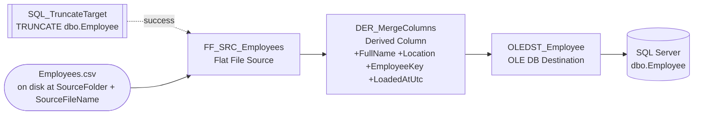
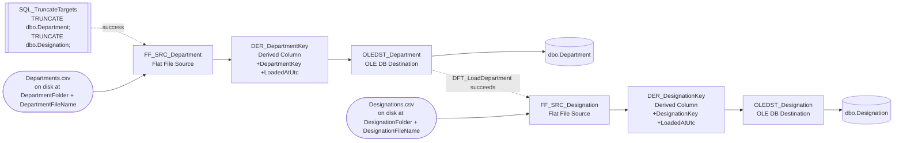

# SSIS PoC — CSV → Derived Column → SQL Server

A minimal SSIS (Project Deployment Model) package that demonstrates the three
capabilities asked for:

1. **Read a CSV** with a Flat File source, whose file path is built from
   project parameters (not hardcoded).
2. **Transform** the data with a Derived Column transform that merges columns.
3. **Load** the result into a SQL Server table via an OLE DB destination,
   whose connection is fully externalized — a project parameter for
   `LoadReferenceData`, and SQL Server Authentication with a genuinely
   protected password for `LoadEmployees` (see "A genuinely protected
   credential" below).

## Layout

```
SSIS.sln
Data/Input/Employees.csv              sample source data (12 employees)
Data/Input/Department/Departments.csv   8 departments
Data/Input/Designation/Designations.csv 10 designations
Sql/
  01_CreateTarget.sql           SsisPoC DB + Employee / Department / Designation tables
  02_SetupCatalogEnvironment.sql SSISDB "Dev" environment + parameter bindings
  03_CreateControlFramework.sql  the ctl schema: registry, run tables, 4 procedures
  04_CreateLoaderCredential.sql  ssis_loader SQL login for LoadEmployees' SQL auth
SSIS/
  SSIS.dtproj                   project file (targets SQL Server 2025 deployment format)
  Project.params                three project parameters (see below)
  LoadEmployees.dtsx            employee load; project parameters only
  LoadReferenceData.dtsx        department + designation loads; package parameters
Scripts/
  PkgRun.cs                     shared execution logic (used by both entry points below)
  Run-Package.ps1               PowerShell entry point
  PkgRun.Console/               C# console entry point (.NET Framework 4.8, in-process)
  SsisRunner/                   .NET 8 console app driving the catalog via ctl (see below)
```

Two packages, two parameter scopes — deliberately. `LoadEmployees` uses only
project parameters; `LoadReferenceData` uses package parameters as well. The
control framework resolves which is which from catalog metadata, so callers
pass a flat name/value bag and never need to know the difference.

## Packages at a glance

| | `LoadEmployees.dtsx` | `LoadReferenceData.dtsx` |
|---|---|---|
| Loads | `dbo.Employee` | `dbo.Department`, `dbo.Designation` |
| Control flow tasks | 1 Execute SQL Task, 1 Data Flow Task | 1 Execute SQL Task, 2 Data Flow Tasks (sequential) |
| Data flows | 1 (source → derived column → destination) | 2, same shape each, one per table |
| Connection managers | `CM_EmployeesCsv` (Flat File), `CM_TargetDb` (OLE DB, SQL auth) | `CM_DepartmentCsv`, `CM_DesignationCsv` (Flat File), `CM_TargetDb` (OLE DB, Windows auth) |
| Parameters | 3 project parameters (shares 2 with the other package) | 4 package parameters + 1 shared project parameter |
| Destination auth | SQL Server Authentication, password protected via SSISDB (§ "A genuinely protected credential") | Windows Integrated Security throughout |

Both packages share the same three building blocks per source file — **Flat
File Source → Derived Column → OLE DB Destination** — and both truncate
their target table(s) before loading, via an Execute SQL Task, so either
package can be re-run without duplicate-key errors. The difference is
`LoadReferenceData` repeats that shape twice (once per CSV) inside one
package, sequentially, sharing one destination connection manager.

## Package: `LoadEmployees.dtsx`

**Control flow**

```
SQL_TruncateTarget  --success-->  DFT_LoadEmployees
     (Execute SQL Task)              (Data Flow Task)
```

`SQL_TruncateTarget` runs `TRUNCATE TABLE dbo.Employee` first so the package
can be re-run without duplicate-key errors.

**Data flow** (`DFT_LoadEmployees`)

```
FF_SRC_Employees --> DER_MergeColumns --> OLEDST_Employee
(Flat File Source)   (Derived Column)     (OLE DB Destination)
```

- **`FF_SRC_Employees`** (Flat File Source) reads `CM_EmployeesCsv` — columns
  `EmployeeID, FirstName, LastName, Department, HireDate, Salary, City,
  State`.
- **`DER_MergeColumns`** (Derived Column) adds four computed columns:

  | New column    | Expression                                              |
  |---------------|----------------------------------------------------------|
  | `FullName`    | `FirstName + " " + LastName`                              |
  | `Location`    | `City + ", " + State`                                     |
  | `EmployeeKey` | `UPPER(SUBSTRING(Department,1,3)) + "-" + EmployeeID`      |
  | `LoadedAtUtc` | `GETUTCDATE()` (audit timestamp)                           |

- **`OLEDST_Employee`** (OLE DB Destination, fast load) writes all eight
  source columns plus the four derived ones into `dbo.Employee` (see
  `Sql/01_CreateTarget.sql` for the table shape — every derived-string
  column is `NVARCHAR`, per the Unicode/non-Unicode trap noted there).

**End-to-end: file on disk → SQL Server table**

Solid arrows are the data flow (rows actually moving); dotted arrows are
control-flow precedence (a task that only *starts* once the previous one
succeeds, same distinction the SSIS designer itself draws between a
precedence constraint and a data flow path).



**Connection managers**

| Name | Type | Purpose | Wiring |
|---|---|---|---|
| `CM_EmployeesCsv` | Flat File | source CSV | `ConnectionString` expression → `User::SourceFilePath` (built from `$Project::SourceFolder` + `$Project::SourceFileName`) |
| `CM_TargetDb` | OLE DB | destination | static `ConnectionString` with SQL Server Authentication (`User ID=ssis_loader;Password=;`) — **not** expression-driven, deliberately, see "A genuinely protected credential" below |

**Parameters this package consumes**

| Parameter | Scope | Role |
|---|---|---|
| `$Project::SourceFolder` | project | folder containing the source CSV |
| `$Project::SourceFileName` | project | source CSV file name |
| `CM.CM_TargetDb.Password` | package (auto-split, sensitive) | `ssis_loader`'s password — bound to environment variable `TargetDbPassword`, see below |
| `CM.CM_TargetDb.ServerName` / `.InitialCatalog` | package (auto-split) | destination server/database — left at design defaults (`.\SQLFORPOC` / `SsisPoC`) unless overridden |

`$Project::TargetConnectionString` exists in the project but this package
does **not** read it — see "A genuinely protected credential" for why.

## Package: `LoadReferenceData.dtsx`

**Control flow** — three tasks, strictly sequential (each gated on the
previous one's success):

```
SQL_TruncateTargets --success--> DFT_LoadDepartment --success--> DFT_LoadDesignation
   (Execute SQL Task)               (Data Flow Task)                (Data Flow Task)
```

`SQL_TruncateTargets` is a single Execute SQL Task running both truncates
against `CM_TargetDb`: `TRUNCATE TABLE dbo.Department; TRUNCATE TABLE
dbo.Designation;` — one task for both tables, unlike `LoadEmployees`' one
task per (single) table.

**Data flow 1** (`DFT_LoadDepartment`)

```
FF_SRC_Department --> DER_DepartmentKey --> OLEDST_Department
(Flat File Source)    (Derived Column)      (OLE DB Destination)
```

- **`FF_SRC_Department`** reads `CM_DepartmentCsv` — columns `DepartmentID,
  DepartmentCode, DepartmentName, CostCenter, HeadCount`.
- **`DER_DepartmentKey`** adds:

  | New column | Expression | Friendly form |
  |---|---|---|
  | `DepartmentKey` | `(DT_WSTR,25)([UPPER](DepartmentCode) + "-" + (DT_WSTR,10)DepartmentID)` | `UPPER(DepartmentCode) + "-" + DepartmentID` |
  | `LoadedAtUtc` | `GETUTCDATE()` | audit timestamp |

- **`OLEDST_Department`** (fast load) writes into `dbo.Department`.

**Data flow 2** (`DFT_LoadDesignation`) — identical shape, different table:

```
FF_SRC_Designation --> DER_DesignationKey --> OLEDST_Designation
(Flat File Source)     (Derived Column)       (OLE DB Destination)
```

- **`FF_SRC_Designation`** reads `CM_DesignationCsv` — columns
  `DesignationID, DesignationCode, Title, JobLevel, Band`.
- **`DER_DesignationKey`** adds:

  | New column | Expression | Friendly form |
  |---|---|---|
  | `DesignationKey` | `(DT_WSTR,25)([UPPER](DesignationCode) + "-" + (DT_WSTR,10)JobLevel)` | `UPPER(DesignationCode) + "-" + JobLevel` |
  | `LoadedAtUtc` | `GETUTCDATE()` | audit timestamp |

- **`OLEDST_Designation`** (fast load) writes into `dbo.Designation`.

**End-to-end: both files on disk → SQL Server** (same solid/dotted
convention as `LoadEmployees` above — solid follows the rows, dotted is
control-flow precedence)



Both data flows share the one `CM_TargetDb` connection manager (and thus
one open connection to the destination) — they just run one after the
other rather than concurrently, per the control-flow precedence shown.

**Connection managers**

| Name | Type | Purpose | Wiring |
|---|---|---|---|
| `CM_DepartmentCsv` | Flat File | Department source CSV | `ConnectionString` expression → `User::DepartmentFilePath` (`$DepartmentFolder` + `\` + `$DepartmentFileName`) |
| `CM_DesignationCsv` | Flat File | Designation source CSV | `ConnectionString` expression → `User::DesignationFilePath` (`$DesignationFolder` + `\` + `$DesignationFileName`) |
| `CM_TargetDb` | OLE DB | destination (both tables + the truncate task) | `ConnectionString` expression → `$Project::TargetConnectionString`; Windows Integrated Security, untouched by the credential work below |

**Parameters this package consumes**

| Parameter | Scope | Default | Role |
|---|---|---|---|
| `DepartmentFolder` | package | `D:\PoC\SSIS\Data\Input\Department` | folder for the Department CSV |
| `DepartmentFileName` | package | `Departments.csv` | Department CSV file name |
| `DesignationFolder` | package | `D:\PoC\SSIS\Data\Input\Designation` | folder for the Designation CSV |
| `DesignationFileName` | package | `Designations.csv` | Designation CSV file name |
| `$Project::TargetConnectionString` | project (shared) | see Configuration below | destination connection for `CM_TargetDb` |

This is the package that exercises the **package-parameter** half of the
`ctl` framework's "resolve scope from catalog metadata" design (§ "Running
many packages from an application") — its four file-path parameters are
package-scoped, unlike anything `LoadEmployees` has.

## Configuration — everything is a parameter, nothing is hardcoded

All three externally-variable settings are **project parameters**
(`SSIS/Project.params`), not literals baked into the package:

| Parameter                 | Default value                                                                                    | Used by |
|----------------------------|---------------------------------------------------------------------------------------------------|---------|
| `$Project::SourceFolder`         | `D:\PoC\SSIS\Data\Input`                                                                    | builds the CSV path |
| `$Project::SourceFileName`       | `Employees.csv`                                                                              | builds the CSV path |
| `$Project::TargetConnectionString` | `Data Source=.\SQLFORPOC;Initial Catalog=SsisPoC;Provider=MSOLEDBSQL.1;Integrated Security=SSPI;Auto Translate=False;` | `LoadReferenceData`'s OLE DB destinations only, as of 2026-08-13 — see below |

**⚠️ Important:** `dtexec`'s local `/Project` execution mode (running a
`.ispac` directly, no catalog) does **not** support overriding `$Project::`
parameters at all — `/Par`/`/Set` for project parameters only work together
with `/ISServer` against a package already deployed to an **SSISDB
catalog**. If you don't have a catalog set up, use
[`Scripts/Run-Package.ps1`](#running-and-overriding-parameters-without-a-catalog)
below instead — it gives the same override capability without that setup.

Wiring, so you can see how the indirection works:

- Package variable **`User::SourceFilePath`** is expression-driven:
  `@[$Project::SourceFolder] + "\\" + @[$Project::SourceFileName]`
- Connection manager **`CM_EmployeesCsv`** (Flat File) has a
  `ConnectionString` property **expression**: `@[User::SourceFilePath]`
- `LoadReferenceData`'s own **`CM_TargetDb`** (OLE DB) has a
  `ConnectionString` property **expression**: `@[$Project::TargetConnectionString]`

`LoadEmployees`' **`CM_TargetDb`** is wired differently, and deliberately
not through `$Project::TargetConnectionString` — see "A genuinely protected
credential" further down for why and how.

Because these are project parameters (not just package variables), they can
be overridden without opening the package:

- **From the command line / `dtexec`**, via `/Set` or `/Param`.
- **From SSISDB**, by mapping an *Environment* variable to the parameter
  after deploying the `.ispac` — the standard way to move Dev → QA → Prod
  without touching the package.

Example of a full override, once deployed to SSISDB (note the semicolon
delimiter, not `=`, and the extra quote-wrapping needed on any value that
itself contains `;`, like a connection string). Shown against
`LoadReferenceData`, the package that still reads `TargetConnectionString`:

```powershell
dtexec /ISServer "\SSISDB\MyFolder\SSIS\LoadReferenceData.dtsx" `
  /Par "$Project::TargetConnectionString(String)";"""Data Source=PRODSQL;Initial Catalog=HR;Integrated Security=SSPI;Provider=MSOLEDBSQL.1;"""
```

An SSISDB catalog **does** now exist on this machine, with both packages
deployed and running server-side. The `dtexec /ISServer` form above is still
untested here, because local `dtexec.exe` is independently broken (COM
registration — see CLAUDE.md) and because `catalog.start_execution` is the
better path anyway. **See "Running many packages from an application" below
for the supported route, or the section after it for catalog-free local runs.**

## A genuinely protected credential

Every connection elsewhere in this PoC uses Integrated Security, which has
no password to protect. `LoadEmployees`' `CM_TargetDb` connection manager
uses **SQL Server Authentication** instead, specifically to demonstrate a
credential that SSISDB actually protects end to end — not just encrypts at
rest with nothing consuming it.

| Piece | What it is |
|---|---|
| SQL login | `ssis_loader` (`Sql/04_CreateLoaderCredential.sql`) — `SELECT, INSERT, ALTER` on `dbo.Employee`, nothing else |
| Environment variable | `TargetDbPassword` in the `Dev` environment (`Sql/02_SetupCatalogEnvironment.sql`), `sensitive = 1` |
| Binding | Bound to the auto-generated `CM.CM_TargetDb.Password` catalog parameter — SSIS splits any connection manager's literal `Password=` out of its `ConnectionString` into its own sensitive parameter at deploy time |

**The value is never readable once set** — not by you, not by package
logic. SSIS only ever *applies* it, inside the OLE DB provider's own login
handshake:

```sql
-- public view: NULL for a sensitive variable
SELECT name, sensitive, value FROM SSISDB.catalog.environment_variables
WHERE name = 'TargetDbPassword';

-- internal table: ciphertext, not plaintext
SELECT name, sensitive, sensitive_value FROM SSISDB.internal.environment_variables
WHERE name = 'TargetDbPassword';
```

**Consequence:** because the password now lives solely inside SSISDB, only
execution paths that actually reach SSISDB can supply it. That's
`ctl.usp_StartPackage` / `SsisRunner`, or `catalog.start_execution`
directly — not the local, catalog-free entry points below, which run
in-process and never touch SSISDB. See the warning under "Running and
overriding parameters without a catalog".

```powershell
.\Scripts\SsisRunner\bin\Release\net8.0\SsisRunner.exe --package LOAD_EMPLOYEES --set SourceFileName=Employees.csv --wait
```

`LoadReferenceData` is untouched — still Integrated Security throughout —
so this is a one-package demonstration, not a project-wide credential
rework. See CLAUDE.md's "Sensitive credential" section for the full
mechanics (how the auto-split works, the permission traps hit setting up
`ssis_loader`, and why a project-level connection manager turned out not to
be required).

## Running many packages from an application — the `ctl` framework

The question this answers: *50 packages, each with different parameters that
change every run, invoked from a .NET service — how do we keep the calling
code minimal and free of SSIS detail?*

SSISDB has no bulk parameter API, so each parameter costs a separate
`catalog.set_execution_parameter_value` call. Fifty packages × eight
parameters is ~450 statements. The framework's job is to move that chatter
inside the server, where it costs microseconds, instead of across the network.

**The application-facing API is four procedures** in `SsisPoC.ctl`:

| Procedure | Round trips |
|---|---|
| `ctl.usp_StartPackage` | 1, starts **one** package, fire-and-forget |
| `ctl.usp_StartRun` | 1, starts **N** packages from a manifest, regardless of how many |
| `ctl.usp_PollRun` | 1 per poll, returns every item's status for one RunId |
| `ctl.usp_PollCorrelation` | 1 per poll, returns every item across **every run** sharing a CorrelationId |

There is no separate retry procedure. Calling `usp_StartPackage` or
`usp_StartRun` again **is** the retry: pass the earlier RunId as
`@RetryOfRunId` for lineage and a higher `@LoggingLevel` (3 = Verbose) if you
want the extra detail. `usp_StartPackage` is a thin wrapper around
`usp_StartRun` — it builds a one-item manifest and delegates — so validation,
dispatch, and the concurrency guard below live in exactly one place.

Both start procedures reject starting a package that already has a `Running`
item for the same `PackageKey`, unless the caller passes
`@AllowConcurrent = 1`. Two overlapping runs of `LoadEmployees` writing
`dbo.Employee` would otherwise interleave silently.

The .NET app never references `SSISDB`, `catalog.*`, `@object_type`, or
execution status codes. Packages are named by logical key
(`LOAD_EMPLOYEES`), resolved through `ctl.PackageRegistry`, so relocating a
package later is a row update rather than an application change.

It is part of `SSIS.sln`, so `devenv SSIS.sln /Build Development` builds it
alongside everything else; `dotnet build` on it alone also works and needs no
Visual Studio.

```powershell
dotnet build Scripts\SsisRunner\SsisRunner.csproj -c Release

# start one package and return immediately (fire-and-forget, the default)
.\Scripts\SsisRunner\bin\Release\net8.0\SsisRunner.exe --package LOAD_EMPLOYEES --set SourceFileName=Employees.csv

# check on it later, from anywhere, by the RunId it printed
.\Scripts\SsisRunner\bin\Release\net8.0\SsisRunner.exe --status 12

# or start and block until it finishes
.\Scripts\SsisRunner\bin\Release\net8.0\SsisRunner.exe --package LOAD_EMPLOYEES --set SourceFileName=Employees.csv --wait

# "retry" is just calling it again, with lineage and verbose logging
.\Scripts\SsisRunner\bin\Release\net8.0\SsisRunner.exe --package LOAD_EMPLOYEES --set SourceFileName=Employees.csv --retry-of 12 --logging-level 3 --wait

# the original N-packages-in-one-manifest path still works
.\Scripts\SsisRunner\bin\Release\net8.0\SsisRunner.exe --manifest Scripts\SsisRunner\manifests\nightly.json --wait
```

Exit codes: `0` succeeded (or, without `--wait`, merely started); `1` at
least one package failed; `2` runner/validation error; `3` — only from
`--status` without `--wait` — the run is still in progress.

Manifest (unchanged shape; each item may still carry its own
`"environment"` override, which now lives on that run's item, not on the
registry, so it never leaks into a later, unrelated call for the same
package):

```json
{
  "correlationId": "nightly-2026-08-12",
  "items": [
    { "packageKey": "LOAD_EMPLOYEES",
      "parameters": { "SourceFileName": "Employees.csv" } },
    { "packageKey": "LOAD_REFERENCE_DATA",
      "parameters": { "DepartmentFileName": "Departments.csv",
                      "DesignationFileName": "Designations.csv" } }
  ]
}
```

### CorrelationId ties a run back to whatever triggered it

`CorrelationId` is an opaque, caller-supplied string with no meaning to the
framework — an upstream job id, a ticket number, anything the caller uses to
find its own request later. It resolves in this order: an explicit
`--correlation` flag, then (manifest mode only) the manifest's own
`"correlationId"` field, then an auto-generated fallback
(`ssisrunner-<timestamp>-<random>`) so every run is still traceable even if
nobody supplied one.

It matters more with `usp_StartPackage` than it did with the manifest: N
independent single-package calls have no RunId in common, so
`CorrelationId` — passed identically to each call — is the only thing left
to group them. `ctl.usp_PollCorrelation @CorrelationId` returns the status
of every item across every run sharing it, which is how "did last night's
load succeed" is answered once there's no single batch RunId to poll.

The sample manifest (`Scripts/SsisRunner/manifests/nightly.json`) does
**not** hardcode a `correlationId` for this reason: a scheduler that reruns
the same file unmodified every night, with a fixed value baked in, would
merge every night's runs into one correlation forever — the opposite of
useful grouping. Leave it out and let the auto-generated fallback give each
invocation its own id, or have the scheduler pass `--correlation
nightly-<run-date>` explicitly if grouping by night is actually wanted.

### Where each value lives

| Value | Held in | Because |
|---|---|---|
| Connection string, base paths | SSISDB environment `Dev` | stable per environment |
| File names, dates, batch ids | **execution override, per run** | volatile |

Per-run values must **not** be written into environment variables.
`set_environment_variable_value` mutates global state, so two overlapping runs
would overwrite each other and silently load the wrong data with no error
raised. Execution overrides are scoped to one `execution_id` and are safe
under concurrency.

### Runs are asynchronous by design

`usp_StartRun`/`usp_StartPackage` start executions without `SYNCHRONIZED`, so
no connection is held for the package duration and a killed pod loses
nothing — the package keeps running in SQL Server and any process can resume
by polling the RunId (or the CorrelationId, across several RunIds). SQL
Server, not the caller, is the system of record. The runner's default
behaviour matches this: `--package`/`--manifest` return as soon as the run is
*started*, not finished; `--wait` opts into blocking.

### Verified end to end

- `usp_StartPackage` started a single package and returned its RunId
  immediately; `--status <runId>` (no `--wait`) read it back mid-run as
  `Running` with exit code 3, then as `Succeeded` with exit code 0 once done.
- Starting the same package a second time while the first was still running
  was rejected: `Package(s) already running: LOAD_EMPLOYEES`. Starting it
  again *after* that first run had finished — with nobody having polled it in
  between — was correctly allowed (the guard refreshes status from SSISDB
  before checking, so a finished-but-unpolled run doesn't block reuse).
- The manifest path is unchanged: one call started both packages; one call
  per poll reported both. 12 / 8 / 10 rows loaded with derived keys correct.
- A misspelled parameter name was rejected **before anything started**:
  `SQL error 50004: Unknown parameter(s): LOAD_REFERENCE_DATA.DepartmnetFileName`
- `--retry-of <runId> --logging-level 3` recorded `RetryOfRunId` correctly
  and produced 423 `operation_messages` for a run that would otherwise log
  ~34 at the default level — consistent with the documented Basic-vs-Verbose
  gap, confirming the logging level actually took effect.

### Not production shape yet

The `ctl` procedures live in `SsisPoC` and call across the database boundary
into `SSISDB`. Ownership chaining does not cross databases, so this works only
because the caller is a local sysadmin. Production needs the procedures signed
with a certificate whose SSISDB user holds the permissions — not
`TRUSTWORTHY ON`. Concurrency *limiting* (a maxParallel cap) and per-package
timeouts are also omitted; the seam for both is marked in
`ctl.usp_RefreshRunItems`.

## Running and overriding parameters without a catalog

`dtexec.exe` on this box can't launch packages at all — see the note
further down — and even where `dtexec` does work, its local `/Project` mode
can't override `$Project::` parameters (see the warning above). So this
repo ships two thin entry points over the same execution logic
([`Scripts/PkgRun.cs`](Scripts/PkgRun.cs)), which runs the package
in-process through the SSIS 17 managed API (`Microsoft.SqlServer.
ManagedDTS`) that `devenv`/`dtexec` themselves sit on top of — functionally
equivalent to a `dtexec` run, but with working parameter overrides and no
catalog required. Pick whichever fits how you want to invoke it.

> **This path no longer works for `LoadEmployees`** (both entry points'
> default package), as of the SQL-authenticated `CM_TargetDb` change
> described under "A genuinely protected credential" below: its password
> lives solely inside SSISDB's encrypted environment variable, unreachable
> by an in-process run that never touches SSISDB. It fails fast with
> *"Login failed for user 'ssis_loader'"* rather than silently using no
> credential. Pass `--package LoadReferenceData.dtsx` /
> `-PackageName LoadReferenceData.dtsx` to use this path — that package is
> still Integrated Security throughout — or run `LoadEmployees` through the
> `ctl` framework below, which does reach the catalog.

### PowerShell — `Scripts/Run-Package.ps1`

Compiles `PkgRun.cs` on the fly via `Add-Type`, no build step needed.

```powershell
# LoadEmployees (the default package) -- source-side parameters still work
# locally; the run still fails at the destination per the box above, since
# ssis_loader's password only exists inside SSISDB.
.\Scripts\Run-Package.ps1 -Override @(
    'SourceFolder=C:\Drop\NewHires',
    'SourceFileName=NewHires.csv'
)

# LoadReferenceData -- still Integrated Security, runs end to end locally
.\Scripts\Run-Package.ps1 -PackageName LoadReferenceData.dtsx -Override @(
    'TargetConnectionString=Data Source=.\SQLFORPOC;Initial Catalog=SsisPoC;Integrated Security=SSPI;Provider=MSOLEDBSQL.1;'
)
```

### C# console app — `Scripts/PkgRun.Console/`

Same logic (`PkgRun.cs` is linked into the project, not copied) behind a
standalone `.exe` — useful if you want to call it from a scheduler,
another .NET program, or anywhere PowerShell isn't the natural fit. Targets
classic .NET Framework 4.8 (net48), because the SSIS managed assemblies are
GAC-only and not available on modern .NET; the assembly is built `x64`
(forced via `PlatformTarget`, since `DTSRuntimeWrap` is a `GAC_64`,
platform-specific assembly) even though it's mapped as `Any CPU` at the
solution-configuration level (see note below).

It's part of `SSIS.sln`, so `devenv SSIS.sln /Build Development` builds
both projects in one shot. It can also be built on its own with the .NET
SDK, without Visual Studio:

```powershell
# either: build everything together
& "C:\...\devenv.com" SSIS.sln /Build Development

# or: build just this project
dotnet build Scripts\PkgRun.Console\PkgRun.Console.csproj -c Release

# LoadEmployees (the default package) -- source-side parameters still work
# locally; the run still fails at the destination per the box above.
.\Scripts\PkgRun.Console\bin\Release\PkgRun.Console.exe `
  --set "SourceFolder=C:\Drop\NewHires" `
  --set "SourceFileName=NewHires.csv"

# LoadReferenceData -- still Integrated Security, runs end to end locally
.\Scripts\PkgRun.Console\bin\Release\PkgRun.Console.exe --package LoadReferenceData.dtsx `
  --set "TargetConnectionString=Data Source=.\SQLFORPOC;Initial Catalog=SsisPoC;Integrated Security=SSPI;Provider=MSOLEDBSQL.1;"
```

`--ispac` and `--package` are also available to point at a different
`.ispac` / package name (`--help` prints all options). The `.ispac` path
defaults to `SSIS\bin\Development\SSIS.ispac`, resolved by walking up from
the exe's location to find `SSIS.sln`, so it works regardless of
Debug/Release output folder.

Both entry points take plain parameter names (`SourceFolder`, not
`$Project::SourceFolder(String)`) — no datatype suffix, no delimiter
escaping. Both were verified working with defaults and with a full
override (redirected source file + a second throwaway database) against
the real `.\SQLFORPOC` SQL Server 2025 instance.

## Target: SQL Server 2025 (`.\SQLFORPOC`)

This machine has a local **SQL Server 2025 Developer Edition** named
instance, `SQLFORPOC`, so both packages point at it by default — a real SQL
Server, not LocalDB, and it matches this project's `TargetServerVersion`
(`SQLServer2025`) exactly. `LoadReferenceData` gets there via
`TargetConnectionString` (`Data Source=.\SQLFORPOC;...`); `LoadEmployees`
gets there via `CM_TargetDb`'s own `ServerName`/`InitialCatalog` properties
plus SQL authentication (see "A genuinely protected credential" below).

**To point `LoadReferenceData` at a different SQL Server**, change one
value — either edit `$Project::TargetConnectionString` in
`SSIS/Project.params` before building, or override it at run/deploy time as
shown above. No package edits needed. **To point `LoadEmployees` at a
different server**, override `CM.CM_TargetDb.ServerName`/`InitialCatalog`
at the catalog level the same way `CM.CM_TargetDb.Password` is bound below.

## How it was verified (on this machine)

1. `Sql/01_CreateTarget.sql` run via `sqlcmd` → created `SsisPoC` DB and
   `dbo.Employee` table on `.\SQLFORPOC`.
2. Project built with `devenv SSIS.sln /Build Development` →
   `SSIS\bin\Development\SSIS.ispac` produced successfully.
3. **Note:** `dtexec.exe` on this box only has the standalone SSIS *design*
   runtime that ships with Visual Studio/SSDT (`...\SSIS\170\Binn\DTExec.exe`,
   v17.0.1016.0), plus a leftover SQL Server 2016 (v13) copy. Neither can
   run this package (`Could not create DTS.Application`, error
   `0x80040154`) because the SQL Server 2025 install here has the Database
   Engine feature only — not the separate "Integration Services" server
   feature that registers the SSIS COM host. The package was instead
   executed in-process through the same managed SSIS 17 API
   (`Microsoft.SqlServer.ManagedDTS`) that `devenv`/`dtexec` themselves sit
   on top of, which is functionally equivalent to a `dtexec` run. On a
   machine with the Integration Services feature installed, run it
   normally:
   ```
   dtexec /Project "SSIS\bin\Development\SSIS.ispac" /Package "LoadEmployees.dtsx"
   ```
4. First run: **0 rows** — the sample CSV had LF-only line endings but the
   Flat File connection manager's row delimiter is CRLF. Fixed by saving
   `Data\Input\Employees.csv` with CRLF endings.
5. Re-ran against LocalDB: **12/12 rows loaded**, spot-checked in SQL.
6. **Parameter-override check**: ran the package again with all three
   parameters pointed at a different folder/file and a second, throwaway
   LocalDB database (`SsisPoC_Test`) — no package changes. It picked up the
   new CSV (3 rows) and wrote them into the new database, proving the
   source and destination are both fully externalized. The test database
   was dropped afterward.
7. Once SQL Server 2025 (`.\SQLFORPOC`) became available, repointed
   `$Project::TargetConnectionString` at it, rebuilt, and re-ran against the
   real server: **12/12 rows loaded**, confirmed with `sqlcmd`:
   ```
   EmployeeID | EmployeeKey | FullName       | Department  | Location    
   1001       | ENG-1001    | John Smith     | Engineering | Austin, TX  
   1006       | HUM-1006    | Elena Petrova  | Human Resources | Denver, CO
   ```
   confirming `EmployeeKey`, `FullName`, and `Location` were all correctly
   merged by the Derived Column transform against the real target.
8. Added `Scripts/PkgRun.Console/` (a C# equivalent of `Run-Package.ps1`)
   to `SSIS.sln`. Its first build via `devenv /Build` **silently skipped**
   the new project ("`Skipped Build: Project: PkgRun.Console`", 0 errors)
   even though the `.sln` correctly listed it as buildable — root cause was
   the `ProjectConfigurationPlatforms` mapping to `Release|x64`; devenv's
   solution build manager wouldn't build a project mapped to a `x64`
   solution-platform in this dtproj-only solution (which only declares a
   `Default` platform), but accepted the same project mapped to
   `Release|Any CPU` instead — the actual compiled bitness is still forced
   to x64 via the project's own `PlatformTarget`, unaffected by this
   solution-level label. After that fix, `devenv SSIS.sln /Build
   Development` builds both projects together (`2 succeeded, 0 skipped`),
   confirmed by running the resulting `PkgRun.Console.exe` with and without
   `--set` overrides — same results as steps 6–7.

## Re-running

```powershell
# rebuild
& "C:\Program Files\Microsoft Visual Studio\2022\Professional\Common7\IDE\devenv.com" SSIS.sln /Build Development

# reset the target table (package also does this itself via SQL_TruncateTarget)
sqlcmd -S ".\SQLFORPOC" -E -i Sql\01_CreateTarget.sql

# run (on a machine with the Integration Services feature installed)
dtexec /Project "SSIS\bin\Development\SSIS.ispac" /Package "LoadEmployees.dtsx"
```
