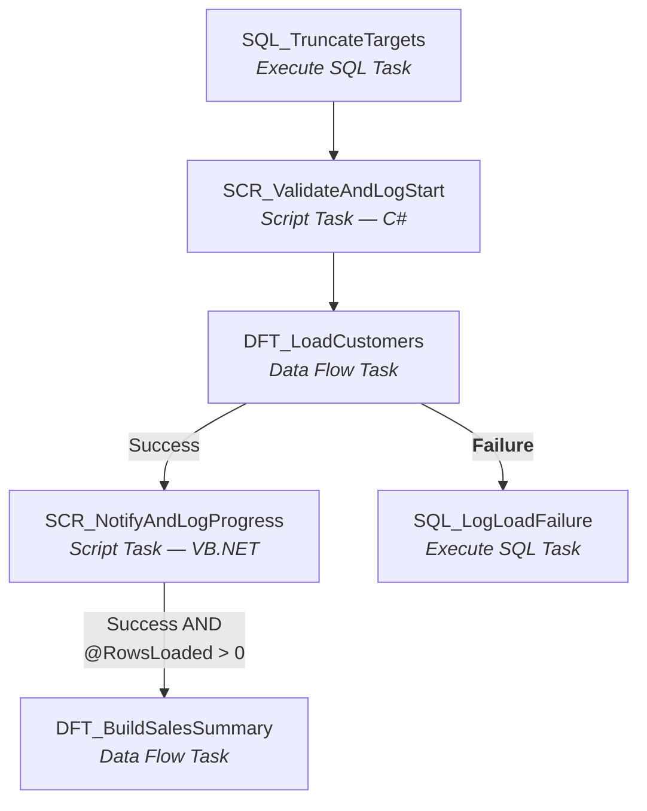
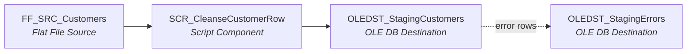
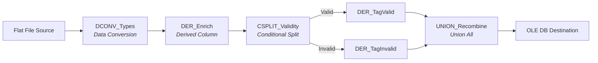
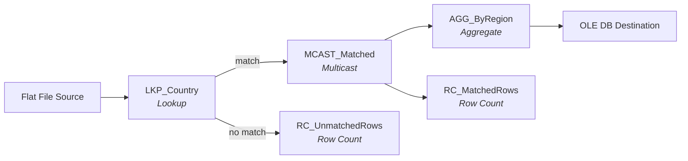
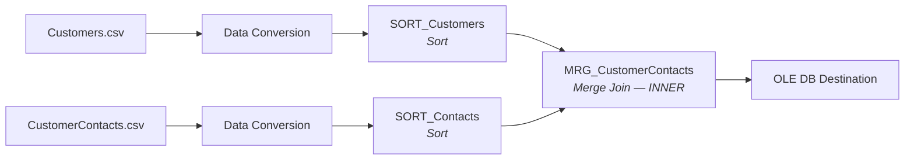
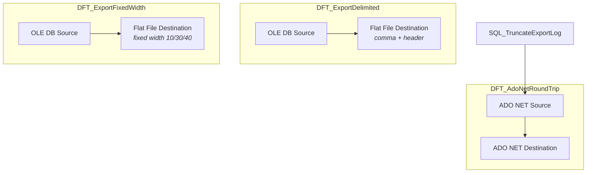
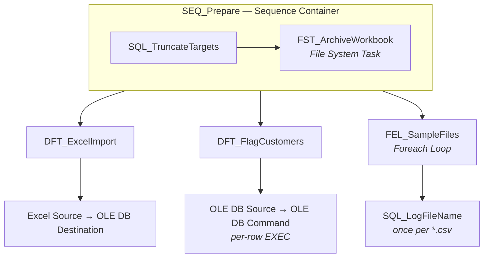
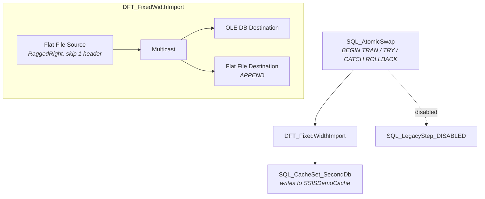

# RBC_Demo_ETL — a teaching SSIS project

A working SSIS project built as a **knowledge-transfer reference** for the RBC N600-ProdProc
migration. It covers ~30 SSIS component types across five packages, chosen to mirror the
component vocabulary actually used by the 44 production packages catalogued in
`N600-ProdProc/docs/SSISAnalysis.md`.

**This README assumes you have never used SSIS.** Sections 1–3 teach the concepts; section 4
walks through each package and the real problem it solves; the rest is setup, verification
and hard-won build notes.

---

## Contents

| # | Section | Read this if… |
|---|---|---|
| 1 | [What SSIS is](#1-what-ssis-is) | you're new to SSIS |
| 2 | [Visual Studio ↔ files](#2-visual-studio--the-files-on-disk) | you opened the solution and can't map the tree to the folder |
| 3 | [SSIS building blocks](#3-ssis-building-blocks) | you need to know what a Task, Component or Connection Manager is |
| 4 | [The five packages](#4-the-five-packages) | you want the use case each package solves |
| 5 | [The C# launcher](#5-the-c-launcher-and-the-net-8-blocker) | you care about the migration blocker |
| 6 | [Setup and running](#6-setup-and-running) | you just want it to run |
| 7 | [How this was built](#7-how-this-was-built-without-the-designer) | you want to script SSIS instead of clicking |
| 8 | [Gotchas](#8-gotchas) | something broke |

---

## 1. What SSIS is

**SQL Server Integration Services** is Microsoft's ETL tool — Extract, Transform, Load. You
use it to move data between places (files, databases, Excel, FTP) and reshape it on the way.

The unit of work is a **package**: one `.dtsx` file. A package is not code you compile — it
is an XML document describing a workflow, executed by the SSIS runtime. You normally build
it by dragging boxes onto a design surface in Visual Studio.

### The two surfaces

This is the single most important concept, and the one newcomers trip over. A package has
**two different design surfaces**, each with its own toolbox:

```
┌─ CONTROL FLOW ────────────────────────────────────────────────┐
│                                                               │
│  The ORCHESTRATION layer. Runs steps in order.                │
│  Each box is a TASK and runs ONCE.                            │
│                                                               │
│   ┌──────────────┐      ┌──────────────┐     ┌────────────┐   │
│   │ Truncate the │─────▶│  Load the    │────▶│  Send a    │   │
│   │ target table │ then │  data        │     │  summary   │   │
│   └──────────────┘      └───────┬──────┘     └────────────┘   │
│                                 │                             │
│                    a Data Flow Task opens ▼                   │
│  ┌─ DATA FLOW ─────────────────────────────────────────────┐  │
│  │                                                         │  │
│  │  The PIPELINE layer. Rows stream through it.            │  │
│  │  Each box is a COMPONENT and runs PER ROW.              │  │
│  │                                                         │  │
│  │   ┌────────┐   ┌─────────────┐   ┌─────────────┐        │  │
│  │   │ Source │──▶│  Transform  │──▶│ Destination │        │  │
│  │   └────────┘   └─────────────┘   └─────────────┘        │  │
│  └─────────────────────────────────────────────────────────┘  │
└───────────────────────────────────────────────────────────────┘
```

| | Control Flow | Data Flow |
|---|---|---|
| Box is called a | **Task** | **Component** |
| Runs | once per package run | once per **row** |
| Arrows are | **Precedence Constraints** (ordering) | **Paths** (rows flowing) |
| Example | "truncate the table" | "trim this column" |
| Opened by | the package itself | double-clicking a **Data Flow Task** |

A **Data Flow Task** is a task on the Control Flow that, when you double-click it, opens a
whole Data Flow surface inside it. That nesting is why the Visual Studio designer has tabs.

### Why anyone cares (the RBC context)

The N600-ProdProc estate has **44 SSIS packages** executed by **29 C# launcher projects**.
Those launchers use an API that cannot run on .NET 8, which blocks the whole modernisation.
This project reproduces the component vocabulary those packages use, so you can learn the
shapes you'll meet — and it reproduces the blocker itself (section 5).

---

## 2. Visual Studio ↔ the files on disk

Open `RBC_Demo_ETL\RBC_Demo_ETL.sln`. Solution Explorer shows this:

```
Solution 'RBC_Demo_ETL' (2 projects)
│
├── 📦 RBC_Demo_ETL                     ← the SSIS project   (RBC_Demo_ETL.dtproj)
│   ├── 📁 Connection Managers          ← PROJECT-level connections (empty here)
│   ├── 📁 SSIS Packages
│   │   ├── 📄 Package.dtsx             ← a file of the same name on disk
│   │   ├── 📄 Package_Transforms.dtsx
│   │   ├── 📄 Package_Exports.dtsx
│   │   ├── 📄 Package_Advanced.dtsx
│   │   └── 📄 Package_Legacy.dtsx
│   ├── 📁 Package Parts
│   ├── 📄 Project.params               ← a real file: Project.params
│   └── 📁 Miscellaneous
│
└── 📦 Launcher                         ← a normal C# project (..\launcher\Launcher.csproj)
    ├── Program.cs
    ├── RbcDtsPackage.cs
    └── DtexecLauncher.cs
```

### Things that surprise newcomers

**A `.dtsx` in the folder is invisible until it's registered.** Solution Explorer lists only
packages declared in `RBC_Demo_ETL.dtproj`. Copying a file into the folder is not enough —
use `tools\Add-PackageToProject.ps1`.

**Connection Managers are not in Solution Explorer.** They live in a **tray along the bottom
of the designer**, and they belong to the package, not the project:

```
┌─ Package_Legacy.dtsx [Design] ────────────────────────────────────┐
│  [Control Flow] [Data Flow] [Parameters] [Event Handlers] [Package Explorer]
│                                                                   │
│        (design surface)                                           │
│                                                                   │
├─ Connection Managers ─────────────────────────────────────────────┤
│  🔌 CM_SQL_SSISDemo   🔌 CM_SQL_SSISDemoCache                     │
│  🔌 CM_FF_CustomersFixed   🔌 CM_FF_AuditTrail                    │
└───────────────────────────────────────────────────────────────────┘
```

**Some files never appear at all.** `config\Package_Legacy.dtsConfig`, everything in
`tools\`, `sql\`, `sample-data\` and `output\` are used by the packages but are not project
items.

**Script code is not a file.** The C# and VB.NET in the Script Tasks lives *inside*
`Package.dtsx` as embedded XML. To see it: double-click the task → **Script** page →
**Edit Script…**, which opens a separate cut-down Visual Studio (VSTA).

### Full map

| On disk | In Visual Studio | What it is |
|---|---|---|
| `RBC_Demo_ETL.sln` | the Solution node | lists the two projects |
| `RBC_Demo_ETL.dtproj` | 📦 **RBC_Demo_ETL** | the SSIS project; also the manifest of which packages exist |
| `Package*.dtsx` | under **SSIS Packages** | one package each |
| `Project.params` | 📄 **Project.params** | project-wide parameters (server, database, credentials, CSV folder) |
| `launcher\Launcher.csproj` | 📦 **Launcher** | C# console app |
| `config\*.dtsConfig` | *not shown* | external XML configuration, loaded at run time |
| `sql\*.sql` | *not shown* | database setup |
| `sample-data\*` | *not shown* | input files |
| `output\*` | *not shown* | files the packages write |
| `tools\*` | *not shown* | the scripts that built these packages |
| `bin\Development\*.ispac` | *build output* | the deployable produced by Build |

### The designer tabs

| Tab | Shows | Used by |
|---|---|---|
| **Control Flow** | tasks and precedence arrows | every package |
| **Data Flow** | the pipeline inside the Data Flow Task picked in the dropdown | every package |
| **Parameters** | package-level parameters | `Package_Advanced` |
| **Event Handlers** | workflows that fire on events like OnError | `Package_Advanced` |
| **Package Explorer** | a tree of everything, including variables | all — useful when you can't find something |

---

## 3. SSIS building blocks

### Connection Manager

A named, reusable pointer to something outside the package. Components refer to it by name,
so changing a server means editing one place.

| Type | Points at | Used here |
|---|---|---|
| **OLEDB** | SQL Server (the classic provider) | all packages |
| **ADO.NET** | SQL Server via `SqlClient` | `Package.dtsx`, `Package_Exports` |
| **FLATFILE** | a text file **and its column layout** | CSV and fixed-width sources/targets |
| **EXCEL** | a workbook, via the ACE driver | `Package_Advanced` |
| **FILE** | a single file or folder, for file operations | `Package_Advanced`, `Package_Exports` |

> A FLATFILE connection manager holds the *schema* — delimiter, column widths, whether row 1
> is a header. That is why fixed-width parsing is configured on the connection, not on the
> source component.

### Task (Control Flow)

| Task | Does |
|---|---|
| **Execute SQL Task** | runs SQL — truncate, DDL, `EXEC` a proc, capture a count |
| **Data Flow Task** | opens a pipeline (the Data Flow surface) |
| **Script Task** | runs C# or VB.NET for anything SSIS can't express |
| **File System Task** | copy/move/delete files and folders |
| **Sequence Container** | a box that groups tasks so they share settings |
| **Foreach Loop Container** | repeats its contents once per file, row, or item |

### Component (Data Flow)

**Sources** produce rows · **Transformations** reshape them · **Destinations** consume them.

| Component | Does | Reach for it when |
|---|---|---|
| **Flat File Source / Destination** | read/write text files | CSV or fixed-width feeds |
| **OLE DB Source / Destination** | read/write SQL tables | the normal database case |
| **ADO NET Source / Destination** | same, via SqlClient | a component needs `SqlClient` types |
| **Excel Source** | read a worksheet | vendor sends a workbook |
| **Derived Column** | add/replace columns from an expression | concatenating, trimming, computing |
| **Data Conversion** | change a column's data type | text file gives you strings, table wants `int` |
| **Conditional Split** | route rows down branches by condition | valid vs invalid rows |
| **Lookup** | join to a reference table | code → description |
| **Sort** | order rows (and mark them sorted) | required before Merge/Merge Join |
| **Merge Join** | join two **sorted** inputs on a key | combining two different feeds |
| **Merge** | concatenate two **sorted** inputs of the same shape | recombining branches in order |
| **Union All** | concatenate inputs, order irrelevant | cheaper than Merge when order doesn't matter |
| **Multicast** | send identical rows to several outputs | write to a table *and* a file |
| **Aggregate** | GROUP BY inside the pipeline | counts/sums without a round trip |
| **Row Count** | count rows into a variable | logging how much moved |
| **OLE DB Command** | run SQL **per row** | ⚠ N+1 — see the warning below |
| **Script Component** | C#/VB per row | logic no stock transform expresses |

> ⚠ **OLE DB Command executes its statement once per row.** For 10 rows that's fine; for a
> million it's a performance disaster. The analysis flags it as blocker **C5** in
> `ImportTradeCount`. It's reproduced here so you can recognise the shape.

### Precedence Constraint

The arrow between two tasks. It carries a condition:

| Arrow | Meaning | Colour in the designer |
|---|---|---|
| **Success** | run next only if this succeeded | green |
| **Failure** | run next only if this failed | red |
| **Completion** | run next either way | blue |
| **+ Expression** | also require an expression to be true | shows an *fx* icon |

### Variables vs Parameters

| | Variable | Parameter |
|---|---|---|
| Changes while running? | **yes** | no — fixed at start |
| Set by | tasks, scripts, expressions | the caller, config, or a default |
| Scope | package or container | package or project |
| Here | `User::RowsLoaded`, `User::BatchStartTime` | `$Project::DatabaseName`, `ExcelFilePath` |

**Project parameters** are shared by every package (`Project.params`). **Package parameters**
belong to one package (`Package_Advanced`). Production's `FXRate_Import` and `TRAN_Import`
use package parameters; older packages use `.dtsConfig` files instead.

### Error outputs

Most components have a second, usually hidden output for rows that fail. Each can be set to
**fail the component** (default), **ignore**, or **redirect the row**. Redirecting lets you
capture bad rows instead of losing the whole batch — production does this in `CUVImport`,
`PN6FTOFPackage` and `MFDBUpdate`.

---

## 4. The five packages

Each section below gives the **use case**, the production package it mirrors, the flow, and
what each piece is doing.

---

### 4.1 `Package.dtsx` — the core ETL

> **Use case:** a nightly customer load. A CSV arrives; clean it, land it in staging, then
> build a sales summary by joining it to orders. Log the batch at start and part-way through.

This is the original deliverable and the one to read first. It's also the only package with
**Script Tasks** and **Script Components** (C# *and* VB.NET).



**Inside `DFT_LoadCustomers`:**



| Piece | Why it's there |
|---|---|
| `SQL_TruncateTargets` | Makes the package **re-runnable**. Without it every run appends. The single most common task in production. |
| `SCR_ValidateAndLogStart` (C#) | Checks the CSV exists, stamps `User::BatchStartTime`, writes a "Batch Start" audit row |
| `SCR_CleanseCustomerRow` | Per-row: trims, derives `FullName`, lower-cases the e-mail, validates, flags `IsValidRow` |
| `OLEDST_StagingErrors` | Error-output redirection — bad rows are captured, not fatal |
| `SCR_NotifyAndLogProgress` (VB.NET) | Counts staged rows, writes "Batch Progress", publishes `User::RowsLoaded` |
| The **Failure** arrow | Alternate path when the load fails — mirrors `CUVImport`'s "file out of date" branch |
| The **expression** arrow | Only build the summary if rows actually landed |

**Result:** 10 staging rows (2 flagged invalid), 7 summary rows, 2 audit rows.
**Mirrors:** `CUVImport`, `MFDBUpdate` (staging + audit + script logic).

---

### 4.2 `Package_Transforms.dtsx` — doing it without code

> **Use case:** the same cleansing as above, but using **stock transformations** instead of a
> Script Component. This is the more common production shape, and the one that migrates most
> easily — a Derived Column is far easier to translate to C# than an embedded script blob.

Four independent data flows, run in sequence.

**① `DFT_DerivedAndSplit` — clean and classify**



Text columns become `int`/`date` (**Data Conversion**), `FullName`/`EmailDomain`/`TenureDays`
are computed (**Derived Column**), rows are routed by validity (**Conditional Split**), each
branch is tagged, and the two are stitched back together (**Union All**).

**② `DFT_LookupAndAggregate` — enrich and summarise**



**Lookup** joins `Country` to a reference table. Two countries are deliberately missing from
that table, so the **no-match output** genuinely fires — the region totals come to 8, not 10.
**Multicast** sends the same rows two ways; **Aggregate** does GROUP BY in the pipeline.

**③ `DFT_SortAndMergeJoin` — combine two feeds**



**Merge Join requires sorted inputs** — that's why two **Sort** components sit in front. The
contacts file omits one customer and adds one who doesn't exist, so the inner join
legitimately drops a row from each side: 9 of 10.

**④ `DFT_MergeSortedBranches` — Merge, not Merge Join**

Splits one stream in two, sorts both, then **Merge** concatenates them back *in key order*.
Merge ≠ Merge Join: Merge Join combines **different** shapes on a key; Merge concatenates
**identical** shapes while preserving sort order.

**Mirrors:** `PN6MSDFEED`, `TRAN_Import`, `MarginReport` (Derived Column + Conditional Split +
Data Conversion), `PN6PinkSheetDN`/`ETAccSSIS` (Lookup/Merge), `UpdateCSEmailFromSF` (Merge Join).

---

### 4.3 `Package_Exports.dtsx` — getting data out

> **Use case:** downstream systems want files, not tables. Produce a delimited extract for one
> consumer and a fixed-width extract for a mainframe, and copy a subset to a log table.

About **15 of the 44** production packages exist mainly to write files.



| Piece | Why |
|---|---|
| Delimited destination | the ordinary CSV extract |
| Fixed-width destination | mainframe/vendor formats where **column position** is the contract |
| **ADO NET** Source/Destination | the `SqlClient` alternative to OLE DB — used by `MODReportDaily_DI`, `SFReport` |
| **FILE** connection manager | a declared run-log path, as `MarginReport` and `TRAN_Import` use |

**Produces:** `output\customers-export.csv`, `output\customers-fixed.txt`.
**Mirrors:** `DSAstExport`, `RORPackage`, `DSMonthlyStats`, `PN6LSTAT`, `MODReportDaily_DI`.

---

### 4.4 `Package_Advanced.dtsx` — orchestration and awkward sources

> **Use case:** a monthly workbook arrives from the business. Import it, archive the original,
> flag the affected customers, and log every file you saw — with error handling and logging
> that survives unattended overnight runs.



| Piece | Why it's there |
|---|---|
| **Sequence Container** | groups the preparation steps so they share settings and can be disabled together |
| **File System Task** | archives the source workbook — production `PN6FTOFPackage` manages error files this way |
| **Excel Source** | reads `.xlsx` via the ACE driver — blocker **C15** in `ImportDrip` |
| **OLE DB Command** | per-row `EXEC` — blocker **C5**, deliberately reproduced |
| **Foreach Loop** | iterates `sample-data\*.csv`, logging each name |
| **Property expression** | the loop's SQL text is *built at run time* from the loop variable |
| **Three parallel branches** | all three start when the container finishes — production `MFDBUpdate`, `DSMonthlyStats`, `PN6LSTAT` do this |
| **Package parameters** | `ExcelFilePath`, `BatchLabel` — the modern injection model |
| **OnError event handler** | writes to `dbo.EtlRunLog` whenever anything errors, anywhere |
| **Log provider** | writes SSIS's own events to `sysssislog` |

> **`DelayValidation = true`** is set on this package. By default the designer validates every
> connection when you *open* the package; here that would need Excel and a running SQL Server.
> Delaying validation to run time means it always opens.

**Mirrors:** `ImportDrip` (Excel), `ImportTradeCount` (OLE DB Command), `PN6FTOFPackage` (file
management), and the `PkgEventListener` pattern all 29 launchers use.

---

### 4.5 `Package_Legacy.dtsx` — the patterns you'll meet in old packages

> **Use case:** a vendor feed arrives as a **fixed-width** file with a header line. Load it
> atomically, append to a running audit trail, update a cache in a **second database**, and
> take the connection strings from an **external config file** rather than the package.

Everything here exists because it's in production, not because it's good practice.



| Piece | Why, and where it comes from |
|---|---|
| **Fixed-width (`RaggedRight`) source** | `CUVImport` parses by exact column widths — 10/30/40/4 here |
| **`HeaderRowsToSkip = 1`** | the file starts with a `CUVHDR` line that isn't data |
| **Append-mode destination** | `Overwrite = false`, so the audit trail grows — `N600ToSalesForce` writes then appends the same file |
| **Two databases** | `SSISDemo` **and** `SSISDemoCache` in one package, like `FXRate_Import` |
| **Atomic T-SQL transaction** | `BEGIN TRAN … TRY … COMMIT … CATCH ROLLBACK`, copied from `MarginReport`'s table-swap |
| **A disabled task** | greyed out in the designer. Blocker **C1\***: `N600ToSalesForce` ships a disabled Script Task whose code still has to be assessed before removal |
| **`.dtsConfig`** | connection strings come from `config\Package_Legacy.dtsConfig` |

#### The `.dtsConfig` trap (blocker C10) — worth understanding

Old packages read settings from an external XML file at run time. Production's
`BPSAFeed.dtsConfig` includes a `Password` entry with an **empty** value, relying on the C#
launcher to inject the real one.

That entry is present in our config **commented out, with an explanation**. Uncomment it and:

```
dtexec           → FAILS: "Login failed for user 'sa'"
Launcher.exe     → SUCCEEDS (it re-injects the connection string after LoadPackage)
```

The empty value overrides the working password. **The package is not self-sufficient** — it
only runs inside its launcher. That is the entire C10 risk in one file.

---

## 5. The C# launcher and the .NET 8 blocker

All 29 production launchers do this:

```csharp
var app     = new Application();                       // Microsoft.SqlServer.ManagedDTS
var package = app.LoadPackage(path, eventListener);
var result  = package.Execute(null, null, eventListener, null, null);
```

`Microsoft.SqlServer.ManagedDTS` wraps COM, ships only with SSDT/the SSIS runtime, isn't on
NuGet, and **has no .NET Core build**. Every processor that runs a package is therefore stuck
on .NET Framework. That is Blocker 1.

The `Launcher` project shows both sides:

| File | Approach | Ports to .NET 8? |
|---|---|---|
| `RbcDtsPackage.cs` | `Application().LoadPackage()` — the production pattern | ❌ **no** |
| `DtexecLauncher.cs` | runs `dtexec.exe` as a child process | ✅ yes |

```bash
launcher\bin\Debug\Launcher.exe both RBC_Demo_ETL\RBC_Demo_ETL\Package_Transforms.dtsx
```

```
=== managed host: Application().LoadPackage()  [.NET 8 BLOCKER] ===
  connection 'CM_SQL_SSISDemo' overridden
  result: Success
=== dtexec child process  [Option B - ports to .NET 8] ===
  dtexec exit code: 0
```

The child-process route is the analysis's recommended short-term unblock (Option B, 2–3 weeks
for all 29 projects). Its trade-offs are real and noted in the file: the `dtexec` path is
version-specific and it breaks in containers.

---

## 6. Setup and running

### 6.1 Database

SQL Server runs in Docker.

```bash
powershell -ExecutionPolicy Bypass -File docker\init-database.ps1
```

Then the objects the showcase packages need:

```bash
sqlcmd -S localhost,1433 -U sa -P "YourStrong!Passw0rd123" -i sql\05_supporting_objects.sql
sqlcmd -S localhost,1433 -U sa -P "YourStrong!Passw0rd123" -i sql\06_legacy_objects.sql
```

`05` creates the lookup, error sink and load targets; `06` creates the **second database**
(`SSISDemoCache`) and the fixed-width/Merge targets. Both are safe to re-run.

### 6.2 Run a package

```bash
"C:\Program Files\Microsoft SQL Server\160\DTS\Binn\DTExec.exe" /File "RBC_Demo_ETL\RBC_Demo_ETL\Package_Transforms.dtsx" /Reporting EW
```

> **`Package.dtsx` is the exception.** It binds its connections to **project parameters**, and
> `dtexec /File` cannot resolve `$Project::*`. `Package.Scripts.WORKING.dtsx` is the same
> package with the parameters inlined — run that one. The other four use literal connection
> strings and run directly.

### 6.3 Expected results

Every number is meaningful, not just non-zero:

| Table | Rows | Why that number |
|---|---|---|
| `StagingCustomers` | 10 (2 invalid) | 10 CSV rows; customer 7 has a bad e-mail, 8 a blank id |
| `SalesSummary` | 7 | invalid rows excluded, and one customer has no orders |
| `EtlAuditLog` | 2 | one row from the C# task, one from the VB task |
| `CustomerEnriched` | 10 | 8 Valid + 2 Invalid, recombined by Union All |
| `RegionSummary` | 4 regions / 8 customers | **not 10** — two countries miss the Lookup |
| `CustomerWithContact` | 9 | inner Merge Join drops one row from each side |
| `CustomerFixedImport` | 8 | **not 9** — the header line was skipped |
| `CacheEntry` (2nd DB) | 1 | written by the second connection manager |

Files in `output\`: `customers-export.csv`, `customers-fixed.txt`,
`legacy-audit-trail.txt` (**grows by 8 lines per run** — that's the append test),
`archived-DripEligibility.xlsx`.

### 6.4 Build

```bash
"D:\Program Files\Microsoft Visual Studio\2022\Professional\Common7\IDE\devenv.com" RBC_Demo_ETL\RBC_Demo_ETL.sln /Rebuild Development
```

Expect `Rebuild All: 2 succeeded, 0 failed` and an `.ispac` containing all five packages.

### 6.5 Checking the logic without SSIS

`sql\04_verify_expected_output.sql` reproduces the whole original package in pure T-SQL. Run
it and diff against what the package produced — it isolates *logic* bugs from *SSIS* bugs.

---

## 7. How this was built, without the designer

Every package here was generated **from the command line**. Useful if you'd rather script
SSIS than click it — and necessary if, like this environment, the designer is unreliable.

```bash
powershell -ExecutionPolicy Bypass -File tools\Build-TransformsPackage.ps1
powershell -ExecutionPolicy Bypass -File tools\Add-PackageToProject.ps1 -PackageFile Package_Transforms.dtsx
```

| Tool | Does |
|---|---|
| `SsisBuilder.cs` | shared helpers — connections, tasks, components, column mapping |
| `_LoadSsisBuilder.ps1` | compiles every builder `.cs` in memory |
| `Build-*.ps1` | one per package |
| `Add-PackageToProject.ps1` | registers a `.dtsx` in the `.dtproj`; **re-syncs identity and parameters** after a rebuild |
| `Add-VbScriptTask.ps1` | adds a VB.NET Script Task via the object model |
| `Update-PackageWithScripts.ps1` | compiles and grafts the C# scripts |

> **Why C# and not PowerShell.** The data-flow object model is COM. Through PowerShell's
> IDispatch, `MainPipe` won't cast (`System.__ComObject`) and `Instantiate()` throws
> `TYPE_E_ELEMENTNOTFOUND`. Compiled C# against the strongly-typed interop drives all 59
> registered components. A pipeline object must therefore never be handed back to
> PowerShell — each package is built inside one C# call.

`SESSION-HANDOFF.md` documents the API rules this uncovered. The one that recurs:
**bind first, type second** — properties like `CopyFromReferenceColumn` and
`AggregationColumnId` supply a column's data type, and setting the type first fails.

---

## 8. Gotchas

**`Customers.csv` must stay CRLF.** The flat file connection expects `\r\n`. An editor that
"helpfully" converts to LF silently breaks the last column of every row.

**Re-running appends unless the package truncates.** Every package here starts with an
Execute SQL Task for exactly that reason.

**`.sln` files need a UTF-8 BOM and CRLF.** Rewriting one without them stops Visual Studio
loading the solution — while `devenv.com /Rebuild` still succeeds, so a scripted build won't
catch it.

**A `.dtsx` on disk isn't in the project.** It must be declared in the `.dtproj`. And after
rebuilding a package, re-run `Add-PackageToProject.ps1`: a rebuild regenerates the package's
GUIDs, and a stale manifest stops Visual Studio opening it.

**Packages are executed by the 160 runtime**, not the VS extension's 170. The
`160\DTS\Binn\*.exe.config` files carry added binding redirects; backups sit alongside them.

**The local `MSSQLSERVER` service is Stopped and Disabled** so Docker owns port 1433. To undo:
`sc config MSSQLSERVER start= auto`.

**ACE (Excel) is registered 64-bit only** on this machine. Anything running 32-bit cannot open
the workbook.

---

## Appendix — component coverage vs the production analysis

**Covered:** Execute SQL Task, Data Flow Task, Script Task (C# + VB), File System Task,
Sequence Container, Foreach Loop · Flat File / OLE DB / ADO NET / Excel sources and
destinations, Script Component · Derived Column, Data Conversion, Conditional Split, Lookup,
Sort, Merge Join, Merge, Union All, Multicast, Aggregate, Row Count, OLE DB Command ·
OLEDB / ADO.NET / FLATFILE / EXCEL / FILE connection managers · project **and** package
parameters, property expressions, Success/Failure/expression precedence, error-output
redirection, event handlers, log providers, parallel execution, `.dtsConfig`, fixed-width +
header skip, append mode, two databases, atomic transactions, disabled tasks.

**Deliberately absent** — production uses none of these, so including them would make the demo
*less* representative: SCD Wizard (C7=0), Fuzzy Lookup/Grouping (C8=0), package encryption
(C9=0), checkpoint/restart (C11=0), sub-package calls (C13=0), third-party components (C14=0).
