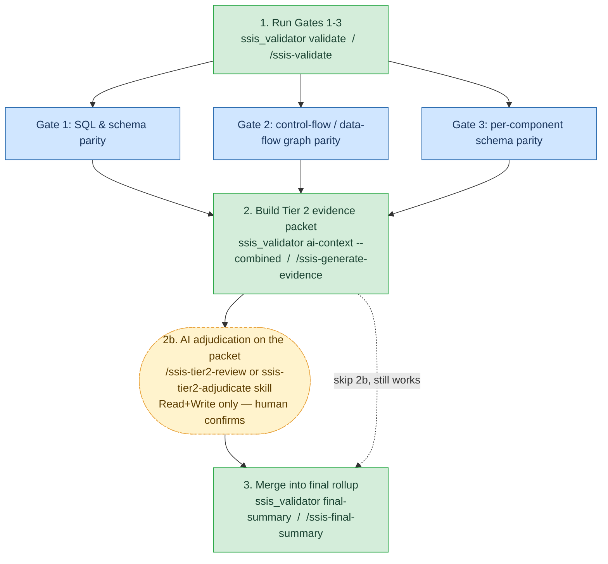
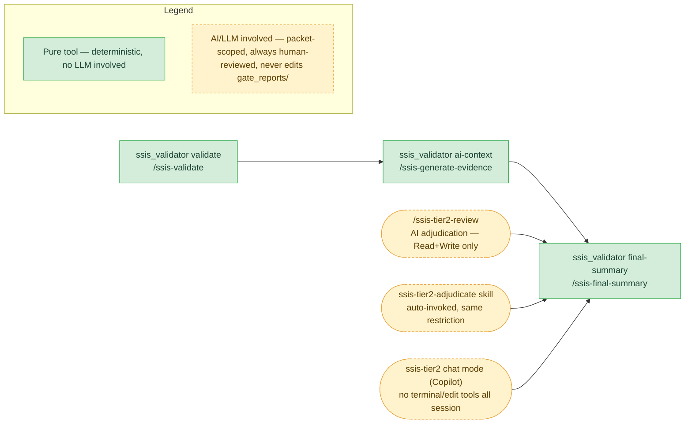

# SSIS Rewrite Validation Tool — Team Handover Guide

**Purpose of this doc:** a walkthrough you can present from on the handover call — what the
tool is, how it works, what it guarantees, and where human/AI judgment sits. It's built from
this repo's own [`README.md`](../README.md), [`CLAUDE.md`](../CLAUDE.md) (the independence
rule), [`docs/ai-validation-prompt.md`](ai-validation-prompt.md),
[`docs/tier2-tooling-setup.md`](tier2-tooling-setup.md), and the actual `ssis_validator/`
source — those stay the authoritative source once this doc drifts out of date.

> Mermaid diagrams below render natively in VS Code (Markdown preview) and on GitHub/GitLab.

---

## 1. What this tool is, and how it works

**One Python CLI, `ssis_validator`**, that checks whether a C# rewrite generated from an SSIS
`.dtsx` package actually reflects what that package does — **without trusting the tool that
generated the rewrite.** The generation tool is treated as an untrusted black box throughout.

| | |
|---|---|
| **Tech stack** | Python 3.11+ (deliberately a different language from the C# it's checking), `xml.etree.ElementTree` for the SSIS side, `sqlglot` for real SQL parsing (not text diff), regex/text extraction over the generated `.cs` (validated against multiple real generated files, never a full C# compiler), `pytest` for tests. |
| **Nothing here ever executes anything.** | No running the SSIS package, no running the generated program, no database connection — ever. Everything comes from reading `.dtsx` XML and generated `.cs` as text/structure. |
| **The independence rule** | Knowledge may only come from Microsoft's public `.dtsx`/SSIS-to-.NET documentation and direct empirical inspection of real `.dtsx`/`.cs` files — never from the generation tool's own source, templates, or internal docs. This is the one rule every line of the tool has to respect. |
| **Every result carries a verdict + evidence** | Never a bare pass/fail, never a silent skip. An unrecognized shape is reported as `Unrecognized`/`Unverifiable` with whatever evidence exists — not ignored. |

### How it extracts from the SSIS side (`.dtsx` is just XML)

Opened with Python's built-in XML parser, purely by recognizing known XML shapes (confirmed
against Microsoft's docs, then checked against all 5 real sample packages — never guessed from
one file):

- **Every SQL statement** the package runs (Execute SQL Task text, a source/destination query, a
  Lookup's reference query, an OLE DB Command's parameterized statement).
- **The control-flow graph** — every task/container as a node, every precedence constraint as an
  edge, so "what runs before what" / "what runs in parallel" is worked out from scratch.
- **The data-flow graph inside each Data Flow Task** — every pipeline component as a node, every
  `<path>` as an edge.
- **Each component's declared column shape** straight from `<externalMetadataColumns>`.
- **Readable business logic where there's no declared shape** — a Derived Column/Conditional
  Split's expression is already stored as readable `FriendlyExpression` text, a Lookup's join
  key/cache mode/no-match routing are plain attributes, a Script Task/Component's actual source
  code is stored as readable text in the XML too.

### How it extracts from the generated C# side (regex over real text)

Matched against structural patterns confirmed by reading multiple real generated files first:

- SQL text embedded in generated string literals.
- The generated call graph — every top-level `await SomeTask(...)`, every `Task.WhenAll(...)`
  parallel group, failure-handler wiring.
- Declared column classes — a generated `sealed class` with only auto-properties, recognized as
  one component's row shape.
- A coarse whole-project presence/absence check, used only for the handful of component types
  that either get a dedicated wrapper class or don't (Sort, Union All, Merge, Row Count).
- **Related-source hunting** — when a Data Flow Task's generated method is just wiring
  (`new SomeTransform(...)`), the tool follows the identifiers it references to the sibling
  file that actually holds the real logic, so later steps aren't stuck looking at a thin wrapper.

### How it validates a rewrite

Three deterministic gates (§5) each produce one **Finding** per item — a verdict plus the
evidence behind it — by comparing the left-side facts above against the right-side facts for
the same thing. Roughly half of everything the gates check ends up `Unverifiable` — not a
failure, an honest "a structural diff can't answer this." That's where the optional, second-tier
AI-assisted review comes in (§3).

---

## 2. The two-tier architecture

```
Tier 1 — Gates 1, 2, 3            Tier 2 — AI-assisted adjudication (optional, advisory)
────────────────────────          ──────────────────────────────────────────────────────
Fully deterministic.              Only for the small slice of findings Tier 1 honestly
No AI involved, ever.             cannot resolve on its own — a business-logic-equivalence
Rule-based comparison of          judgment ("does this generated code do the same thing as
.dtsx XML vs. generated C#.       this expression?"), not a structural comparison.

Verdicts: Match / NormalizedMatch /   Verdicts: AiConfirmedMatch / AiSuspectedDiscrepancy /
Mismatch / LeftOnly / RightOnly /     AiInconclusive / AiNotApplicable — never merged into
Unrecognized / Unverifiable           Tier 1's reports, never authoritative on its own.
```

**Status today:** all three Tier 1 gates are implemented and proven against all 5 sample
packages. Tier 2 is built and has already been run for real against two of them, with real
worked examples sitting in `gate_reports/` — including a genuine discrepancy caught (a Lookup's
"no-match rows" tracking silently dropped in the rewrite), a cross-cutting pattern spotted across
three unrelated Script Components, and two resolved correlation gaps.

---

## 3. How gaps are found, and how AI helps close them

Gates 1–3 run first and never call an AI model. What's left over — the genuine `Unverifiable`/
`LeftOnly` findings that a structural diff truly cannot settle — becomes a **gap**, and that's
the only place AI enters, in one mechanical step plus one judgment step:

**Step A — build the evidence packet (`ai-context` command, no AI, pure extraction).** For every
surviving gap that's a real judgment call, package exactly what a reviewer needs and nothing
else. Three shapes of question show up:

| Packet section | The question being asked | Example |
|---|---|---|
| `## Components` | "Does this generated code implement the same *logic* as this SSIS-side evidence?" | Does this C# method do the same thing as this Derived Column expression / Lookup / Script? |
| `## Correlation gaps` | "Which generated code even represents this component, if any?" | Gate 3 couldn't correlate an OLE DB Command or Flat File Destination by schema — the packet gives either a known correlate (reused from Gate 1's own SQL-content match) or a short, **capped** list of name-mention candidates, never an open-ended search. |
| `## Left-only gaps` | "Tier 1 actively confirmed nothing was generated for this — double-check that conclusion." | A missing call site, or one of the Sort/Union All/Merge/Row Count no-counterpart cases — in case the same logic exists under a different name Tier 1's naming-based checks can't see. |

**Step B — a human hands that packet to an AI, following the rulebook in
[`docs/ai-validation-prompt.md`](ai-validation-prompt.md).** The AI only ever sees the packet —
never the `.dtsx`, never other generated files, never the generation tool's own self-reporting.
It answers with `AiConfirmedMatch` / `AiSuspectedDiscrepancy` / `AiInconclusive` /
`AiNotApplicable` (or `AiFoundUnmappedImplementation`/`AiConfirmedGap` for a left-only gap), each
with a cited rationale, saved as a **new** file right next to the packet — never merged into or
overwriting Tier 1's own gate reports.

### The guardrails, restated once

1. **The evidence packet is the only input** — never the `.dtsx`, other generated `.cs` files, or
   anything belonging to the generated project's own self-reporting (`gaps/`, `extract/`, `svk/`,
   `coverage-report.md`, its own `README.md`) — using that would defeat the point of an
   independent validator.
2. **Never fabricate a match.** Missing evidence is `AiInconclusive`, stated precisely.
3. **Required verdict vocabulary only**, each with a rationale citing specific packet evidence.
4. **Advisory only** — Tier 1's `gate_reports/` are never edited by a Tier 2 run; a human still
   reads and confirms the review before it means anything.
5. A request to "just check the real code to be sure" is **declined, not honored** — if evidence
   is genuinely missing, the fix is extending the evidence-packet builder itself, not a one-off
   manual peek that breaks the audit trail.

---

## 4. The gates — how many, and how each one validates

| Gate | Checks | Mechanism | What a clean result proves |
|---|---|---|---|
| **Gate 1 — SQL & schema parity** | Every SQL statement and table/column schema the package declares (Execute SQL Task, source/destination query, Lookup reference query, OLE DB Command) vs. its generated counterpart | Matches items by name, then compares the two statements as **parsed SQL** via `sqlglot` — not raw text, so formatting differences never create a false mismatch | The SQL the rewrite actually runs is structurally the same SQL the package declared |
| **Gate 2 — control-flow / data-flow graph parity** | The `.dtsx`'s task/container graph (nodes, precedence-constraint edges, concurrency groups computed from scratch) vs. the generated code's own call order/`Task.WhenAll` groups | Walks the graph level by level. For components *inside* one Data Flow Task, only a name-presence signal is available on its own (not proof) — but it **defers to Gate 3's own verdict** for the same component whenever Gate 3 already ran a real schema comparison, instead of re-reporting the weaker signal | Tasks run in the same order, and in the same parallel groupings, as the original package |
| **Gate 3 — per-component input/output schema parity** | Declared column name + type shape per data-flow component vs. its generated counterpart, using Microsoft's published SSIS-to-.NET type mapping | Correlates a destination by (schema, table) identity (reusing Gate 1's proven match), a source by its generated factory-method name, a non-database destination by its enclosing factory method's name, plus a project-wide presence/absence check for component types with no generated counterpart anywhere (Sort, Union All, Merge, Row Count) | Every column a component declares survives the rewrite with the right name and the right .NET type |

A component with no declared external shape to compare (Derived Column, Conditional Split,
Lookup, Aggregate, Merge Join, Script Component) now carries **structured semantic evidence** on
its `Unverifiable` finding instead of a bare "nothing to compare" message — the readable
expression, resolved lineage, decoded sort direction, or Script source — so a human or Tier 2 can
act on it without re-reading the raw `.dtsx`.

Net effect on the 5 sample packages so far: 10 of 82 originally-`Unverifiable` Gate 3 findings
have been resolved into real, tool-solvable verdicts (8 `LeftOnly`, 2 `Match`); every remaining
`Unverifiable` finding with a registered semantic extractor now carries real evidence.

---

## 5. Commands — what they take, what they produce

Exactly **three CLI subcommands**, always run in this order for one package (steps 2–2b are
optional but recommended):

| # | Command | Needs AI? | Input | Output |
|---|---|---|---|---|
| 1 | `ssis_validator validate --dtsx <path> --generated <dir> [--out <root>]` | No | One `.dtsx` file + its matching generated project folder | `gate_reports/<pkg>/gates/<pkg>.gate{1,2,3}.{json,md}` — non-zero exit if any Gate 1 finding is `Mismatch`/`LeftOnly`/`RightOnly`/`Unrecognized`, any Gate 2 finding is `Mismatch`/`LeftOnly`/`RightOnly`, or any Gate 3 finding is `Mismatch`/`LeftOnly` |
| 2 | `ssis_validator ai-context --dtsx <path> --generated <dir> --combined` | No — just packages the evidence | Same `.dtsx`/generated-folder pair | `gate_reports/<pkg>/ai_context/<pkg>.ai-context.{json,md}` (standalone `gaps/*` files too, in non-`--combined` mode) |
| 2b | *(hand the packet to an AI)* | **Yes** | The packet from step 2 | `gate_reports/<pkg>/ai_context/<pkg>.ai-review.{md,json}` |
| 3 | `ssis_validator final-summary --package <name> [--reports-root <root>]` | No — just merges 1 + 2b | The files from steps 1 and (optionally) 2b | `gate_reports/<pkg>/final_review/<pkg>.final-summary.{json,md}` |

All three commands share one reports-root directory (`gate_reports` by default) and each derives
its own named sub-path automatically — you never type the same directory three different ways.
Step 3 works even if steps 2/2b are skipped entirely; everything unresolved just falls to
Human-Needs-Review instead of a chance at AI-Verified.

### The same sequence, as Claude Code / GitHub Copilot slash commands

Identical four-step pipeline, identical command names in **both** tools — only the chat window
differs:

| # | Step | Slash command | Input you supply | If you skip it |
|---|---|---|---|---|
| 1 | Run Gates 1–3 | `/ssis-validate <Package>` | Just the package name — auto-discovers the matching `.dtsx`/generated folder, asks only if it finds none or more than one | Nothing to merge later — Gate reports are required for step 3 |
| 2 | Build the Tier 2 evidence packet | `/ssis-generate-evidence <Package>` | Same auto-discovery | Fine to skip — step 3 still runs, everything stays Human-Needs-Review |
| 2b | Get an AI verdict | `/ssis-tier2-review <Package>` (Claude Code also auto-invokes this via the `ssis-tier2-adjudicate` skill on plain language) | Nothing extra — reads the packet step 2 wrote | Same as skipping step 2 |
| 3 | Merge into the final rollup | `/ssis-final-summary <Package>` | Just the package name | Only the raw per-gate files, no single combined view |

Every one of these four commands checks for `.venv` and creates it (`python -m venv .venv` +
`pip install -e ".[dev]"`) if it's missing, before running anything — no manual setup required
first.

---

## 6. SSIS components supported

Coverage comes from the validator's own registries — the same handler recognizes either a
friendly name (`"OLE DB Source"`) or the canonical `componentClassID`
(`Microsoft.OLEDBSource`), per Microsoft's own documentation; anything not on this list is never
silently skipped — it's reported as an honest `Unrecognized`/`Unverifiable` finding with
whatever evidence exists.

| Category | Components / tasks with explicit handling |
|---|---|
| **Sources** | OLE DB Source, Flat File Source, Excel Source, ADO.NET Source (`DataReaderSourceAdapter`) |
| **Destinations** | OLE DB Destination, Flat File Destination, ADO.NET Destination |
| **Transforms with dedicated schema/semantic handling** | Derived Column, Conditional Split, Lookup, Aggregate, Merge Join, Sort, Script Component (`ManagedComponentHost`/`ScriptComponentHost`) |
| **Transforms handled for SQL/graph extraction** | Multicast, Data Convert, OLE DB Command, Union All, Merge, Row Count |
| **Confirmed "no generated counterpart" cases** | Sort, Union All, Merge, Row Count — the validator has a dedicated registry (`no_translation_registry.py`) recognizing these as legitimately having no dedicated wrapper in a rewrite, rather than treating their absence as ambiguous |
| **Control-flow tasks** | Execute SQL Task, Script Task, Data Flow Task (the `Pipeline` container itself), Package (root container) |

---

## 7. How token/LLM cost is kept down

- **The `--combined` flag on `ai-context`** (the tool-level fix behind this) — every generated
  source file the evidence resolves to is listed **once**, in a `## Sources` section, and every
  component references it by path instead of re-embedding it. This both shrinks the token
  footprint and means a whole package can be adjudicated in **one** AI conversation instead of
  one per component.
- **The evidence packet is engineered to be self-contained** — "exactly what a reviewer needs and
  nothing else" — so the AI never needs to re-read the `.dtsx` or hunt through unrelated
  generated files to answer a question the packet already answers.
- **Related-source hunting happens ahead of time** (`codegen/csharp_related_source.py`) — the
  tool resolves a thin wrapper method to the sibling file with the real logic *before* Tier 2 ever
  sees the packet, instead of leaving the AI to search for it.
- **Correlation-gap candidate lists are capped, never open-ended** — a bounded list of
  name-mention candidates, not "go search the project."
- **Permission-layer restriction on the judgment step itself** — the Claude Code review
  command/skill is scoped to `Read`+`Write` only (no Bash, no Glob/Grep, no web), and the Copilot
  equivalent runs in file-edit-only mode — both enforced at the tool layer, not just written
  instruction, so the AI structurally cannot wander off and burn tokens exploring files outside
  the packet.
- **Gate 2 defers to Gate 3's verdict** for the same component instead of re-reporting its own
  weaker name-presence signal — avoids a redundant, lower-confidence finding ending up in the
  packet at all.

---

## 8. The prompt/command library — Claude Code and GitHub Copilot

Both tools expose the **identical four-step pipeline**, only the invocation differs. Deliberately
split into a mechanical step (no AI, normal tool access) and a judgment step (AI, tool access
restricted) — so guardrails only constrain the step that actually needs constraining.

### Claude Code (`.claude/`)

| File | Slash command | Tool access | Job |
|---|---|---|---|
| `commands/ssis-validate.md` | `/ssis-validate <Package>` | Bash (CLI + venv setup) + Read | Run Gates 1–3. No AI. |
| `commands/ssis-generate-evidence.md` | `/ssis-generate-evidence <Package>` | Bash (CLI + venv setup) + Read/Grep/Glob | Emit the combined Tier 2 packet. No AI judgment. |
| `commands/ssis-tier2-review.md` | `/ssis-tier2-review <Package>` | **Read + Write only** | The actual AI adjudication — cannot run Bash, search the filesystem, or reach the web |
| `commands/ssis-final-summary.md` | `/ssis-final-summary <Package>` | Bash (CLI + venv setup) + Read | Merge Tier 1 + Tier 2 into the four-bucket rollup |
| `skills/ssis-tier2-adjudicate/SKILL.md` | Auto-invoked on natural language ("review the Tier 2 evidence for X") | **Read + Write only** | Same job as the slash command, for when you don't type the exact name |

### GitHub Copilot (`.github/`)

| File | Invocation | Job |
|---|---|---|
| `copilot-instructions.md` | Automatic on every Copilot Chat request in this repo | Always-on context: the independence rule, the two-tier architecture, common commands |
| `prompts/ssis-validate.prompt.md` | `/ssis-validate` | Runs Gates 1–3 (agent mode, terminal tool). No AI. |
| `prompts/ssis-generate-evidence.prompt.md` | `/ssis-generate-evidence` | Runs the CLI to build the Tier 2 packet. Mechanical. |
| `prompts/ssis-tier2-review.prompt.md` | `/ssis-tier2-review` | The AI adjudication, `mode: edit` — file edits only, no terminal/web |
| `prompts/ssis-final-summary.prompt.md` | `/ssis-final-summary` | Merges Tier 1 + Tier 2 into the four-bucket rollup |
| `chatmodes/ssis-tier2.chatmode.md` | Select "ssis-tier2" from the chat-mode dropdown | An alternative to the prompt file — a whole chat mode with no terminal/edit tools for the entire session |

---

## 9. Reports generated, and where

```
gate_reports/
  <Package>/
    gates/<Package>.gate{1,2,3}.{json,md}        Tier 1 output — validate
    ai_context/<Package>.ai-context.{json,md}    Tier 2 evidence packet — ai-context
    ai_context/<Package>.ai-review.{md,json}     Tier 2 verdict — a human-run AI review
    gaps/*.correlation-gap.ai-context.*          Standalone gap packets — non-combined
    gaps/*.left-only-gap.ai-context.*            ai-context mode only
    final_review/<Package>.final-summary.{json,md}   Tier 1 + Tier 2 rollup — final-summary
```

- **JSON** — machine-readable, for anything downstream that reads it back (e.g. `final-summary`
  reading `ai-review.json`).
- **Markdown** — for a human to open and read directly.
- **The final rollup's four buckets:** **Tool-Verified** (Tier 1 alone proved it), **Exception**
  (Tier 1 structurally proved there's nothing to check — e.g. a disabled SSIS task), **AI-Verified**
  (Tier 1 couldn't resolve it, Tier 2 came back clean), **Human-Needs-Review** (everything else).

One package's report never mixes with another's — each gets its own subfolder, and each report
type inside it has its own named subfolder, so `gates/`, `ai_context/`, `gaps/`, and
`final_review/` never sit loose at the top level.

> **Housekeeping note for whoever runs this next:** clean a package's own `gates/` subfolder
> before rerunning `validate` for it — never a sibling package's folder or an archive folder — so
> old and new runs are never mixed.

---

## 10. Pipeline flow — tool steps vs. the AI boundary



Steps 1, 2, and 3 are the same deterministic Python CLI every time — no AI, no judgment calls.
Step 2b is the **only** point an AI model is ever involved, and it's optional: skipping it just
means more findings land in Human-Needs-Review instead of a chance at AI-Verified.

## 11. Command/prompt classification — pure tool vs. AI/LLM



---

## 12. Where to go deeper

- [`README.md`](../README.md) — the full step-by-step mechanics and command reference this doc summarizes.
- [`SSIS-Rewrite-Validation-Plan.md`](../SSIS-Rewrite-Validation-Plan.md) — the original design plan and the independence rule in full.
- [`CLAUDE.md`](../CLAUDE.md) — the working discipline (read real samples first, prove every gate can fail before trusting it can pass, generic-not-package-specific).
- [`docs/ai-validation-prompt.md`](ai-validation-prompt.md) — the canonical Tier 2 rulebook (what evidence to use, required output format, guardrails).
- [`docs/tier2-tooling-setup.md`](tier2-tooling-setup.md) — the exact file behind each Claude/Copilot integration and its tool-access restrictions.
- [`docs/dtsx-xml-notes.md`](dtsx-xml-notes.md) / [`docs/dtsx-graph-notes.md`](dtsx-graph-notes.md) — the empirical `.dtsx`/generated-C# shapes extraction is built from.
- `gate_reports/` itself — real, worked examples from actual validation + adjudication runs across all 5 sample packages.
